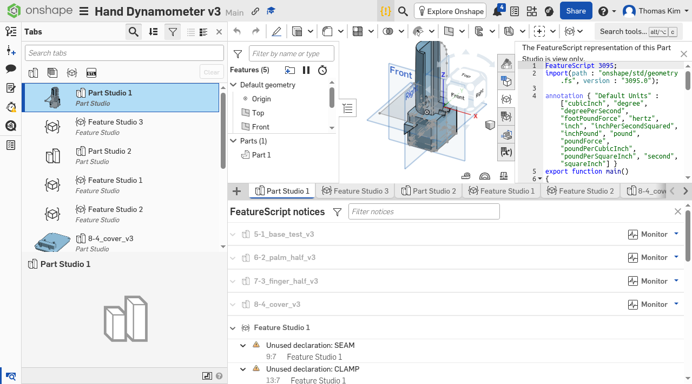
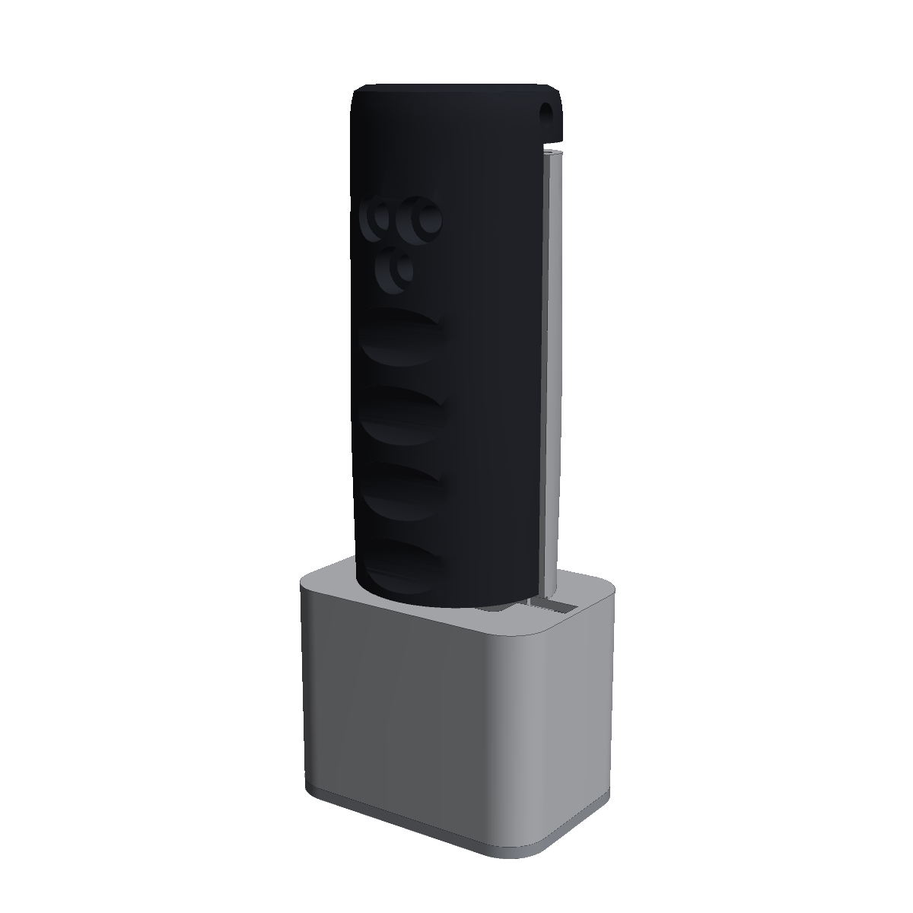
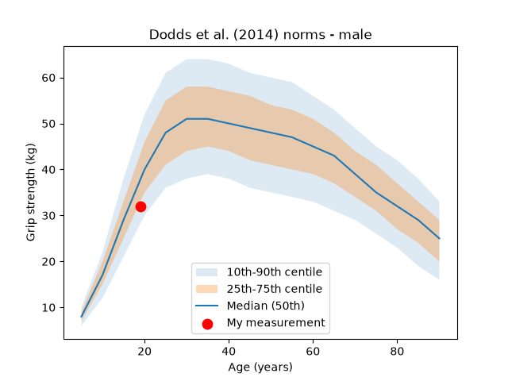

# hand-dynamometer

<<<<<<< HEAD
A low-cost, 3D-printed grip strength dynamometer built around a load cell, an HX711 amplifier, and an Arduino, together with a Python application that administers a standardized grip test, analyzes the full force-time curve, and compares the result with published normative data.

> **Educational project.** This device is not a medical device and is not intended for diagnosis or clinical decision-making.
=======
A handheld grip-strength instrument built around a **CZL601 100 kg load cell**. Its barrel-shaped handle splits into two halves; an **HX711** amplifier and **Arduino Nano** read the load cell and send the data to a laptop. Calibration uses known masses through the same load path as a real squeeze.

**Current version: v3** — The split-grip barrel handle has a **flat chamfered top** and sits on a **closed 57 × 82 mm electronics box** (~204 mm tall) for the Nano, HX711 and coiled, uncut cable. All four v3 parts are **native, from-scratch parametric models** in Onshape — **[Hand Dynamometer v3](https://cad.onshape.com/documents/14d87426a9f5f0f89acb0ff1/w/cbee608c747a369f00bd9d19/e/3240b9b82e6414542f1a770b)** (private). The palm half, finger half, bay cover and base test were rebuilt feature by feature (sketches, revolves, extrudes and bolt pattern) from `cad/dynamometer_cad.py` and the v3 mesh measurements. The Jamar-style two-handle concept, a possible **v4 prototype** (`docs/13_jamar_concept.md`, `cad/jamar_concept.py`), is modeled in the same document as a separate part studio with a frame, palm bar, finger part and cover. The renders below show v2 (dome top, round flared base); v3 renders are still pending. Superseded v2 CAD files remain in `cad/archive/superseded_2026-10-16/`.

**CAD status:** All five Onshape part studios regenerate cleanly as native parametric models; known open items are tracked in [docs/14_cad_open_items.md](docs/14_cad_open_items.md).
## Screenshots

Onshape proof captures for the v3 parts and Jamar concept:

- [Palm half](docs/proofs/palm-half.png)
- [Finger half](docs/proofs/finger.png)
- [Bay cover](docs/proofs/cover.png)
- [Base test](docs/proofs/base.png)
- [Jamar v4 concept](docs/proofs/jamar.png)


>>>>>>> d8162cbdc2115a0417334c894a0a0b3449b50b7d

<p align="center">
  
</p>
---

<<<<<<< HEAD
## Motivation

Grip strength is one of the simplest and most widely used indicators of overall muscle function. It is associated with mobility, recovery after surgery, and all-cause mortality, and it is a core criterion in current definitions of sarcopenia. Clinical dynamometers such as the Jamar, however, report only a single peak value and cost several hundred dollars.

This project was undertaken to examine whether an inexpensive device could reproduce that peak measurement while also recording the entire force-time curve. Access to the full curve allows metrics that a mechanical dial cannot provide, including the rate at which force develops and the extent to which it declines during sustained effort.

---
=======
The grip splits lengthwise. The **grey palm half** bolts to the bottom of the load cell, and the **black finger half** bolts to its top. A 3 mm seam keeps the halves apart, so every squeeze has to pass through the load cell.


A full explanation of the features and design process is in **[`docs/12_design.md`](docs/12_design.md)**.
>>>>>>> d8162cbdc2115a0417334c894a0a0b3449b50b7d

## Features

<<<<<<< HEAD
- **Standardized protocol.** The application guides the user through three maximal trials per hand, alternating hands to allow recovery, followed by a 30-second sustained-effort fatigue test. Posture instructions and verbal encouragement are fixed in the code so that every trial is administered identically, in keeping with the American Society of Hand Therapists (ASHT) recommendations.
- **Live visualization.** Force is plotted in real time on a scrolling five-second window while each trial is recorded.
- **Five force-time metrics.** Peak force, time to peak force, rate of force development (RFD), fatigue index, and bilateral asymmetry are computed for every session.
- **Normative comparison.** The best grip is compared with age- and sex-specific values from Dodds et al. (2014) and reported as a percentile band, a Z-score, an estimated percentile, and a T-score. The EWGSOP2 and AWGS 2019 cut-offs for low grip strength are applied to users aged 65 and over.
- **Complete data retention.** Every session is saved under a unique timestamp as a raw force-time file, a per-trial summary file, and a centile plot, so that new metrics can later be computed from existing recordings without repeating the test.
- **Hardware-independent development.** A single setting (`USE_FAKE`) switches between the Arduino and a realistic simulated signal, which allows the entire application to be run and tested without the device.
=======
Grip strength is a validated clinical measure and a diagnostic criterion for sarcopenia (EWGSOP2: < 27 kg for men, < 16 kg for women). In the PURE study of about 140,000 people, it predicted mortality better than systolic blood pressure. A clinical standard device costs several hundred dollars and reports one number; this one logs the full force–time curve at 10 Hz.
>>>>>>> d8162cbdc2115a0417334c894a0a0b3449b50b7d


### Example output

---

## How to run

### Requirements
- Python 3.9 or later
- matplotlib
- pyserial (only required when the Arduino is connected)

<<<<<<< HEAD
```bash
pip install matplotlib
```
=======
The top-level Python app runs a standardized grip test on the device, or on fake data while the hardware is being built:
>>>>>>> d8162cbdc2115a0417334c894a0a0b3449b50b7d

### Run with simulated data (no hardware required)
```bash
python grip_test.py
```
Enter age, sex, and dominant hand when prompted, then press Enter before each trial. Results are printed to the terminal and saved to the `sessions/` folder.

### Run with the Arduino
1. Install pyserial: `pip install pyserial`
2. Upload `firmware/grip_firmware/grip_firmware.ino` to the board.
3. Find the serial port: `python -m serial.tools.list_ports`
4. In `grip_test.py`, set `USE_FAKE = False` and set `PORT` to the port found in step 3.
5. Run `python grip_test.py` and release the handle when asked to zero the sensor.

### Other scripts
| Command | Purpose |
|---|---|
| `python fake_data.py` | Plots one simulated maximal trial and one simulated fatigue trial |
| `python metrics.py` | Computes all metrics on simulated curves as a quick self-check |
| `python grip_compare.py` | Prints normative reports for four example cases |

---

## Project structure

```
hand-dynamometer/
├── grip_test.py        # Main application: protocol, live plot, saving, summary
├── metrics.py          # Peak force, time to peak, RFD, fatigue index, asymmetry
├── grip_compare.py     # Comparison with Dodds et al. (2014) norms and clinical cut-offs
├── fake_data.py        # Simulated force-time curves for hardware-free testing
├── cad/                # 3D-printable enclosure and handle design files
├── docs/               # Design notes and documentation
├── firmware/           # Arduino firmware (HX711 load cell, 50 Hz serial output)
├── data/
│   └── dodds2014_norms.csv
├── images/             # Figures used in this README
├── practice/           # Earlier development versions, kept for reference
└── sessions/           # Saved test sessions (excluded from version control)
```

### Data format
The Arduino and the simulator both send one line per sample, at 50 samples per second:
```
timestamp_ms,force_kg
```
Because the simulator follows exactly the same format as the firmware, no other part of the code needs to change when the real device is connected.

---

## Metric definitions

| Metric | Definition |
|---|---|
| **Onset** | The first sample at which force exceeds 5% of the trial's peak. A relative threshold is used so that sensor noise is not mistaken for the start of a squeeze. |
| **Peak force (kg)** | The highest force recorded during the trial. The best of three trials per hand is reported, consistent with the method used to construct the normative data. |
| **Time to peak (ms)** | The time from onset to peak force. |
| **Rate of force development (N/s)** | The slope of a least-squares line fitted to force (converted to newtons, 1 kg = 9.81 N) over the first 200 ms after onset. Fitting a line to all points in the window, rather than using only the first and last points, reduces the influence of individual noisy samples. |
| **Fatigue index (%)** | (Peak force − mean force during the final second of the 30 s effort) ÷ peak force × 100. The final second is averaged rather than taken as a single point to reduce the effect of noise. |
| **Bilateral asymmetry** | The ratio of left-hand to right-hand peak force, together with the percentage by which the weaker hand is weaker. The commonly cited "10% rule" for the dominant hand is not applied, because the literature does not support it consistently; the values are reported without a verdict. |

---

## Normative data

Normative grip strength values are transcribed from Table 2 of:

Dodds RM, Syddall HE, Cooper R, et al. (2014). Grip Strength across the Life Course: Normative Data from Twelve British Studies. *PLoS ONE* 9(12): e113637. https://doi.org/10.1371/journal.pone.0113637 (CC BY 4.0)

The measurement is matched to the row with the closest age and the same sex. The Z-score uses that row's mean and standard deviation, and the T-score uses the young-adult peak (age 32) from the same study.

### Why 27 kg and 16 kg?
The EWGSOP2 cut-offs for low grip strength (men < 27 kg, women < 16 kg) correspond to a T-score of −2.5 relative to the young-adult peak reported by Dodds et al. (2014):
- Men: 51.9 − 2.5 × 9.9 = 27.15 kg
- Women: 31.4 − 2.5 × 6.1 = 16.15 kg

Both EWGSOP2 (Cruz-Jentoft et al., 2019) and AWGS 2019 (Chen et al., 2020) define these cut-offs for older adults, so they are reported only for users aged 65 and over.

---

## Validation (in progress)

<<<<<<< HEAD
The software has been developed and tested using simulated signals. Validation of the physical device is planned in two stages:
=======
```
cad/        dynamometer_cad.py   the whole design, parametric; regenerates every part and checks it
            render_final.py      the renders in images/
            draw_final.py        the dimensioned drawing
            output/              STL + STEP per part, assembly.step
            output/print_ready/  STLs ready for Bambu Studio — don't rotate them
            archive/             earlier design iterations
firmware/   grip_firmware/       Arduino sketch
software/   logger.py, calibrate.py, analyze_hold.py   serial logging and calibration
grip_test.py, metrics.py, grip_compare.py, fake_data.py   the grip test app (above)
data/       dodds2014_norms.csv, example calibration points
docs/       everything above, incl. 13_jamar_concept.md (v4 prototype concept)
images/     renders, drawings, and your photos
```
>>>>>>> d8162cbdc2115a0417334c894a0a0b3449b50b7d

1. **Calibration.** Known masses will be applied across the measurement range (at least five points), and linearity will be reported as maximum deviation as a percentage of full scale rather than R², since R² is close to 1 for almost any load cell and therefore says little about accuracy.
2. **Agreement with a clinical device.** Paired measurements will be taken with this device and a Jamar hydraulic dynamometer under the same ASHT protocol, and agreement will be assessed with Bland-Altman analysis (bias and 95% limits of agreement). Correlation alone is not used, because two devices can be perfectly correlated while still disagreeing by a constant amount.

Results will be added to this section once the hardware is complete.

---

## Limitations

- All results shown in this repository were produced with **simulated data**. They demonstrate that the analysis pipeline works, not that the device is accurate.
- The normative data come from British cohorts and may not represent other populations.
- The comparison uses the nearest age band rather than interpolating between bands.
- The estimated percentile assumes that grip strength is normally distributed within each age band, which is an approximation.
- Any future validation will involve a small number of participants (the authors), so it will indicate feasibility rather than establish clinical accuracy.

---

## Authors

- **Thomas Kim** — hardware design, mechanical assembly, and Arduino firmware
- **Samuel Koo** — Python application, signal analysis, and normative comparison

## License

<<<<<<< HEAD
Software is released under the MIT License. Hardware design files, documentation, and images are released under CC BY 4.0. See [LICENSE](LICENSE) for details.
=======
Code: MIT. Hardware design files and documentation: CC BY 4.0.

>>>>>>> d8162cbdc2115a0417334c894a0a0b3449b50b7d
