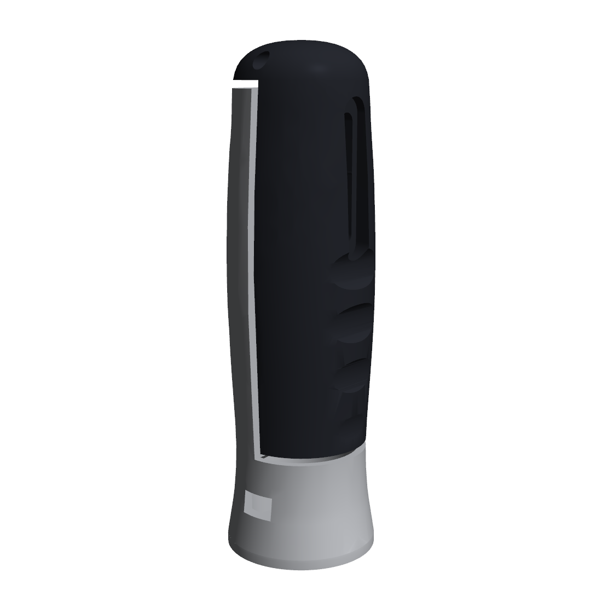
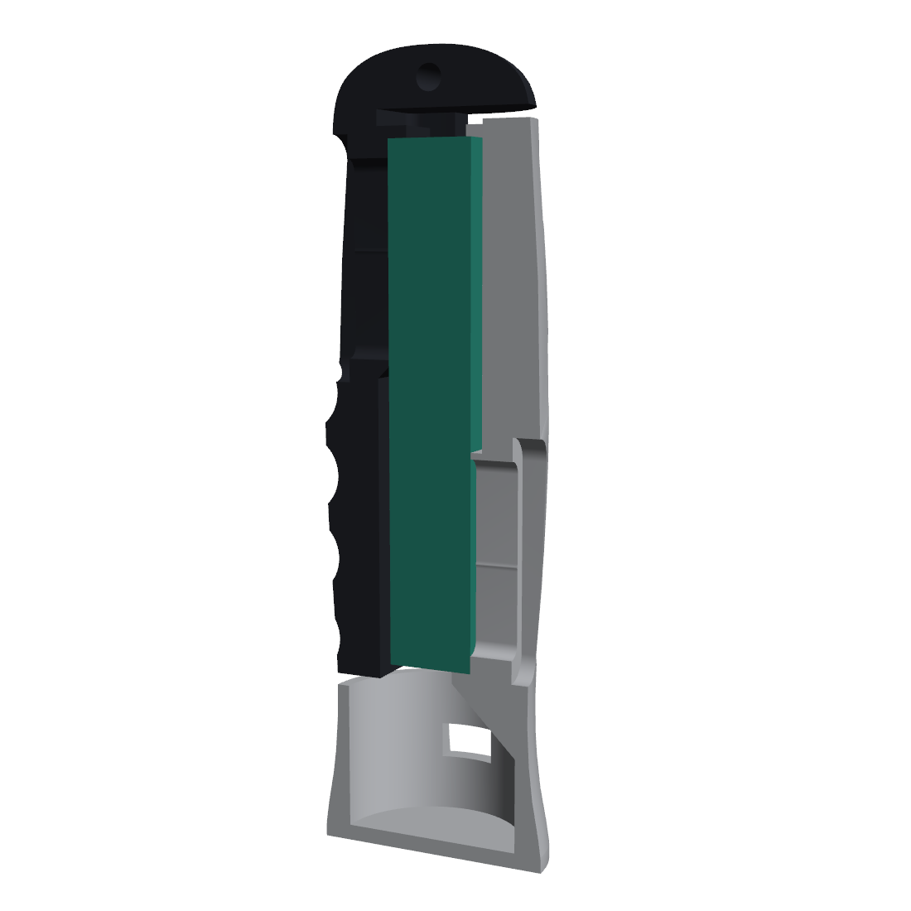
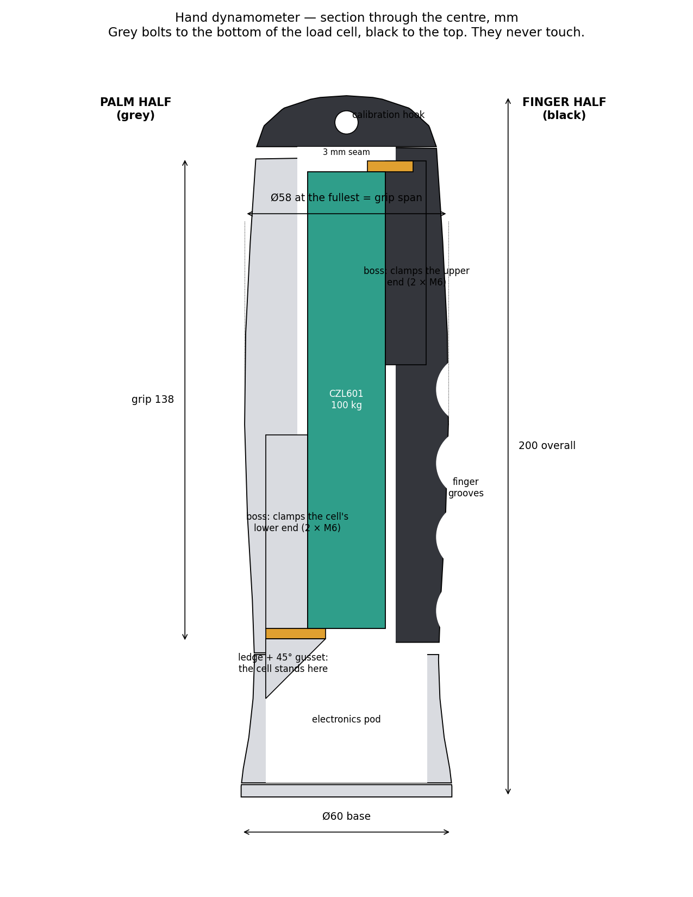

# Hand Dynamometer — a 3D-printed grip-strength meter with a calibration report

A handheld grip-strength instrument: a barrel-shaped handle split into two halves around a **CZL601 100 kg load cell**, read by an **HX711** amplifier and an **Arduino Nano**, logged to a laptop. Calibrated against known masses through the same load path as a real squeeze.



## How it works

The grip is split lengthwise. The **grey palm half** bolts to the load cell's bottom end; the **black finger half** bolts to its top end. A 3 mm seam keeps them apart everywhere, so when you squeeze, **all of the force has to pass through the load cell.**





Full explanation of every feature, and how the design was arrived at: **[`docs/12_design.md`](docs/12_design.md)**.

## Why

Grip strength is a validated clinical measure — a diagnostic criterion for sarcopenia (EWGSOP2: < 27 kg men, < 16 kg women), and in the PURE study of ~140,000 people it predicted mortality better than systolic blood pressure. The clinical standard device costs several hundred dollars and reports one number; this one logs the whole force–time curve at 10 Hz.

**Educational and non-diagnostic. Not a medical device.**

## Results

*Fill in from `docs/05_calibration_report.md`.*

| Quantity | Measured | Load cell spec |
|---|---|---|
| Calibrated range | 0 – __ kg | 100 kg rated |
| Sensitivity | ______ counts/kg | ~43,000 expected |
| Max non-linearity | __.___ % FS | ±0.03 % FS comprehensive |
| Hysteresis | __.___ % FS | — |
| Repeatability (3 runs) | __.___ % FS | — |
| Creep, 20 kg / 30 min | __.__ % | ±0.023 % FS / 30 min |
| **Verification error, unseen mass** | **__._ %** | target ≤ 2 % |

## Grip test app

The Python app at the top level runs a standardized grip test against the device (or against fake data while the hardware is being built):

| File | What it does |
|---|---|
| `grip_test.py` | 3 trials per hand with countdown and rest, live plot, each session saved to a timestamped file (115200 baud, same as the firmware) |
| `metrics.py` | peak force, time to peak, rate of force development |
| `grip_compare.py` | compares a result with age- and sex-specific norms and plots it on the centile curves |
| `fake_data.py` | realistic fake grip and fatigue curves for testing without hardware |
| `data/dodds2014_norms.csv` | normative values (source below) |

## Data
Normative grip strength values are transcribed from Table 2 of:

Dodds RM, Syddall HE, Cooper R, et al. (2014). Grip Strength across the Life Course: Normative Data from Twelve British Studies. *PLoS ONE* 9(12): e113637. https://doi.org/10.1371/journal.pone.0113637 (CC-BY 4.0)

## Why 27 kg / 16 kg?
The EWGSOP2 cut-offs for weak grip (men < 27 kg, women < 16 kg) correspond to a T-score of -2.5 relative to the young-adult peak in Dodds et al. (2014):
- Men: 51.9 - 2.5 x 9.9 = 27.15 kg
- Women: 31.4 - 2.5 x 6.1 = 16.15 kg

## Build it

| Step | Doc |
|---|---|
| The load cell — buy, check, measure | `docs/00_load_cell.md` |
| Electronics and firmware, start to finish | `docs/11_firmware_tutorial.md` |
| Printing at the Rapid Prototyping Centre | `docs/02_printing.md` |
| Assembly | `docs/03_assembly.md` |
| Calibration | `docs/04_calibration.md` |
| Report template | `docs/05_calibration_report.md` |
| Day-by-day plan | `docs/09_daily_plan.md` |
| Verification checklist | `docs/08_verification_checklist.md` |

**Print the fit coupon first** and bolt your load cell to it before printing the halves.

## What's in the repo

```
cad/        dynamometer_cad.py   the whole design, parametric; regenerates every part and checks it
            render_final.py      the renders in images/
            draw_final.py        the dimensioned drawing
            output/              STL + STEP per part, assembly.step
            output/print_ready/  STLs ready for Bambu Studio — don't rotate them
            archive/             earlier design iterations
firmware/   grip_firmware/       Arduino sketch
software/   logger.py, calibrate.py, analyze_hold.py   serial logging and calibration
grip_test.py, metrics.py, grip_compare.py, fake_data.py   the grip test app (above)
data/       dodds2014_norms.csv, example calibration points
docs/       everything above
images/     renders, drawings, and your photos
```

## Parts and cost

`docs/bom.csv`. About **$65** to buy (load cell, HX711, Nano, four M6 × 25 bolts) plus **~$20** of printing. Tools are borrowed from the DEN.

## Team

- **Thomas Kim** — mechanical design, printing, electronics, firmware, calibration
- **Samuel Koo** — grip test app, metrics, normative comparison

## License

Code: MIT. Hardware design files and documentation: CC BY 4.0.
