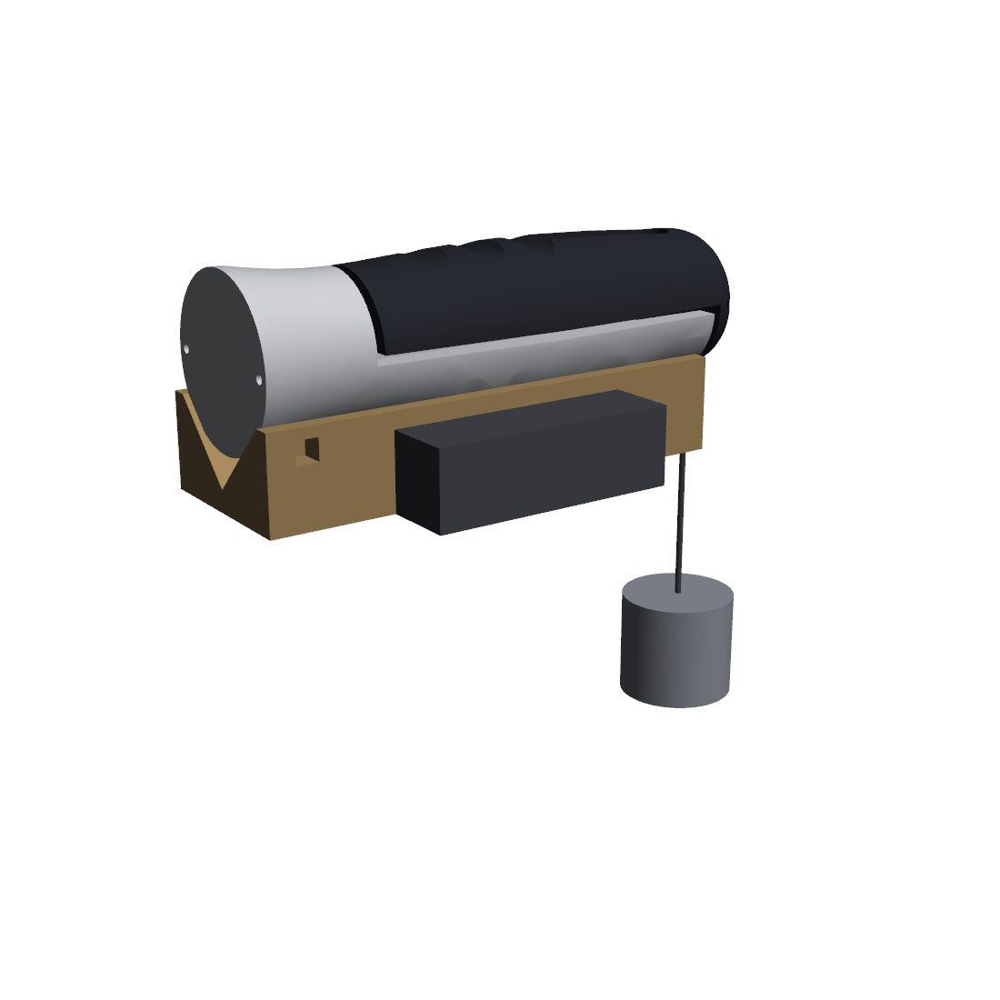

# 04 — Calibration and characterization

This is the part of the project that makes it an instrument rather than a gadget. Budget a full afternoon, two people.

## The principle

**Load the cell exactly the way a squeeze does.** A squeeze pulls the black finger half toward the grey palm half, through the four mounting bolts. So the calibration masses must pull the finger half the same way, through the same bolts. Calibrating any other way — pressing on the cell directly, hanging from the cell, loading the wrong direction — gives readings that look fine and are wrong.

## The rig



1. Nothing comes apart. The device stays fully assembled.
2. Clamp the **calibration cradle** in a bench vise by its flat sides, V-groove facing up.
3. Lay the device in the V with the **grey palm half facing down** and the black finger half facing up. The base goes at the end with the zip-tie slots.
4. Thread a **zip tie through the two slots and over the base pod** (grey) and pull it snug. This stops the device tipping when the weight hangs off the far end. **It must never go around the black half** — that would join the halves and bypass the load cell.
5. Tie a cord through the **hole in the dome**. It hangs straight down past the end of the cradle, touching nothing but the dome.
6. Hang a bucket or bag from the cord. Masses go in the bucket.
7. **Direction check — do not skip.** Press the black half toward the grey half by hand and watch `net` go positive. Then hang a mass: `net` must go positive **too**. Same sign means the rig loads the cell exactly like a squeeze. If they differ, the device is upside down in the cradle.

No cradle printed yet? Two pieces of 2×4 wood screwed together in a V do the same job.

## Masses

Weigh **every** mass on a scale before use and write down the actual value. Nominal weights are wrong: a "10 kg" gym plate is often 9.7 or 10.3.

Easy sources:
- Water: 1 litre = 1.000 kg at room temperature. Bottles and jugs in the bucket.
- Gym plates from the campus gym (weighed first).
- The DEN's calibration weights, if they have a set — these are the best option.

Target: **8 points from 0 to 30–40 kg**, roughly evenly spaced. 0, 5, 10, 15, 20, 25, 30, 35 is ideal. This covers the range grip strength actually occupies; the cell is rated to 100 but you'll report the calibrated range honestly.

## The session

**Warm-up.** Power the Arduino and leave it for 5 minutes with the bucket hanging empty. Drift in the first minutes is normal and would corrupt your zero.

**Run 1.**
1. With the empty bucket hanging and nothing touching the device, start `python software/logger.py <port> --label cal_run1`. Opening the port **reboots the Nano**, and the firmware zeroes itself on boot, so it zeroes with the empty bucket. Wait about 5 seconds until the readout starts scrolling near 0.
2. Add mass 1. Wait 10 s for the reading to settle. Note the stable `net` value from the readout. **Do not stop or restart the logger between masses.** Restarting reboots the Nano and re-zeroes it with the mass still hanging, which silently ruins the run. Keep it running for the whole up-and-down sequence, then press Ctrl+C.
3. Add mass 2. Wait. Note. Continue to the top mass. This is the **ascending** sequence.
4. Remove masses one at a time, noting the reading at each step, down to the empty bucket. This is the **descending** sequence. The difference between ascending and descending readings at the same mass is hysteresis.
5. Note the empty-bucket reading again.

**Runs 2 and 3.** Stop the logger, remove every mass, start the logger again (that re-zeroes it), wait 5 s. Repeat the whole up-and-down sequence twice more. The spread between runs at each mass is repeatability.

**Record everything** in `data/calibration_points.csv`:

```
mass_kg,net_counts,direction,run
0,12,up,1
4.98,41230,up,1
...
```

`mass_kg` is the actual weighed value including the bucket if you didn't tare it out. Simplest: tare with the empty bucket hanging, then `mass_kg` is just what you added.

**Fit.**
```
cd data
python ../software/calibrate.py calibration_points.csv
```
It prints `COUNTS_PER_KG`, R², nonlinearity, hysteresis, repeatability, and saves two plots. Paste `COUNTS_PER_KG` into the firmware, upload.

**Sanity-check the slope before you go further.** For a 100 kg CZL601 at 2.0 mV/V on an HX711 at gain 128, expect roughly **43,000 counts/kg**. Within ±30 % means your wiring and gain are right. Around half suggests channel B or a 1.0 mV/V cell; roughly double suggests a 50 kg cell. This catches wiring errors that a beautifully linear fit would otherwise hide.

**Verify.** Hang a mass you did **not** use in calibration — say 12.4 kg. Read `force_kg` directly. The error, as a percentage of that mass, is your headline accuracy number. Record it.

## Characterization

Do these the same day or the next. Each is one logging session.

| Test | Procedure | Output |
|---|---|---|
| **Noise floor** | Empty bucket hanging, log 60 s | Standard deviation of `net`, ÷ COUNTS_PER_KG, in kg |
| **Zero drift** | Empty bucket hanging, log 30 min | Change in `net` from first minute to last, in kg |
| **Creep** | Hang ~20 kg, log 30 min | Change in reading over the hold, as % of applied load. Cell spec is ±0.023 % FS over 30 min; anything much worse is the printed frame. |
| **Nonlinearity** | From calibrate.py | max residual, % FS |
| **Hysteresis** | From calibrate.py | max up–down difference, % FS |
| **Repeatability** | From calibrate.py | max std across runs, % FS |

Creep matters especially for a printed frame — PLA or PETG under sustained load deforms slowly. Under 20 kg for 30 minutes, if the reading rises or falls by more than ~0.5 %, that's the plastic, not the cell. Report it. It's a real finding about the design.

## What the numbers mean

**R² above 0.999 is easy and tells you little.** Report the max residual as a percentage of full scale instead — that's the honest linearity figure. A load cell datasheet will say something like "nonlinearity 0.05 % FS"; you're measuring the same thing for your whole instrument.

**The calibrated range is the validated range.** If you calibrated to 35 kg, say the device is validated 0–35 kg and that readings above are extrapolated. Don't claim 0–100 because the cell is rated 100.

**The sensor is not your limiting factor.** At ~43,000 counts/kg and an HX711 noise floor of a few tens of counts, the cell resolves about a gram. Your own grip varies by 2–4 kg between consecutive squeezes — three orders of magnitude larger. Say this in the report; knowing where the real uncertainty lives is the point of characterization.

**Compare your numbers against the cell's datasheet.** The CZL601 is specified at ±0.03 % FS comprehensive error and ±0.023 % FS creep over 30 minutes, accuracy class C2. Whatever you measure beyond those figures came from your frame, your mounting or your reference masses — not the sensor. Working out which is the most interesting paragraph in your report.

## Things that go wrong

| Symptom | Cause |
|---|---|
| Readings creep up slowly with a constant mass | Warm-up (first 5 min) or plastic creep (after). Note which by timing. |
| Descending readings consistently higher than ascending | Hysteresis. Usually something rubbing — redo the clearance checks. Some is inherent to the printed frame; report it. |
| One run is offset from the others | Zero drifted. Start each run with a fresh logger launch and record the zero at the start and end. |
| Residuals curve (positive in the middle, negative at ends) | Real nonlinearity, often from the frame flexing. Report it. Stiffer frame is future work. |
| Reading jumps when you touch the bench | Vise not rigid, or the cord is touching something. |

## After calibration

Fill in `05_calibration_report.md`. That document, with your real numbers and photos, is the deliverable.
