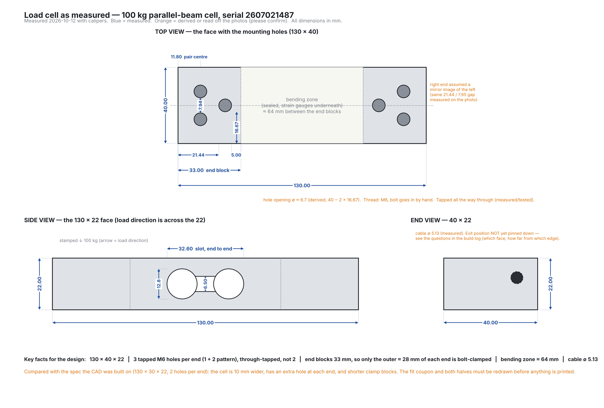
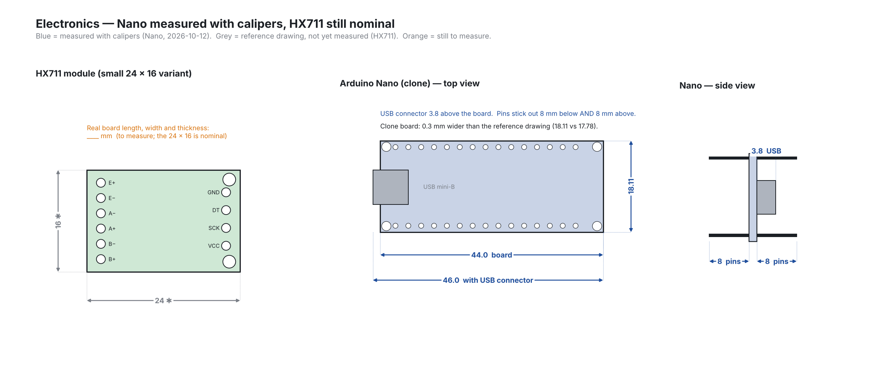
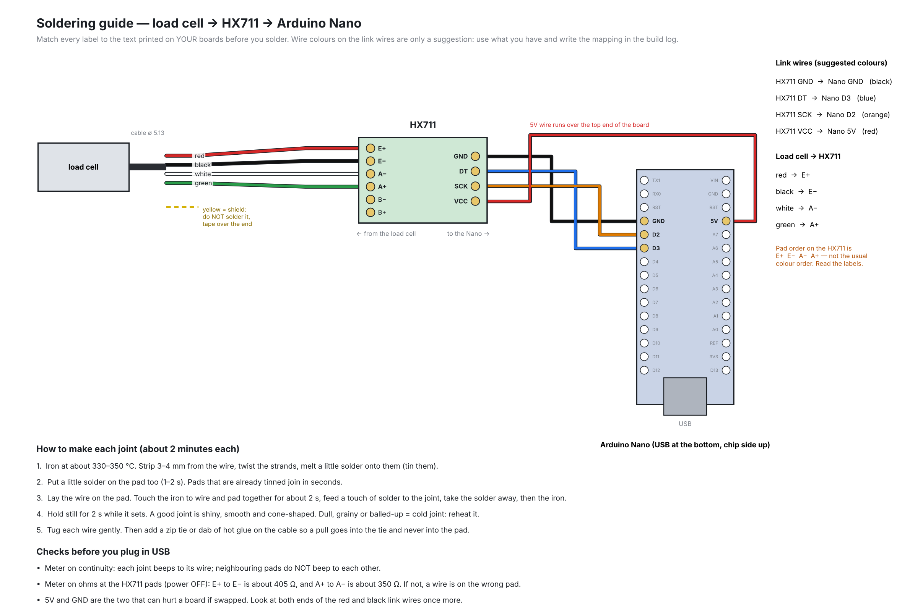

# 06 — Build log and schedule

**Started:** Friday, September 25, 2026
**Target:** device calibrated and report drafted by **Sunday, November 8, 2026**
**Buffer:** November 9–22 for slippage, then exams.

## How to use this file

Every time you do anything on the project, add an entry at the bottom. Date, who, what you did, what happened, what's next. Two lines is fine. Photos go in `images/` and get linked. This file *is* your engineering notebook, and it's what proves you ran a process rather than just producing an object.

Commit it every time you edit it. `git commit -m "log: printed fit coupon, cell bolts on"` — done.

## Schedule

| Week | Dates | Person A (mechanical) | Person B (software) | Gate |
|---|---|---|---|---|
| 1 | Sep 18–21 | Check DEN Sensors (Force). Order CZL601 100 kg parallel-beam cell + HX711, Nano, 2x M6×35 and 2x M6×30 bolts + 4 washers, M6 stop. Book printer. | Install Arduino IDE + Python. Run `logger.py fake`. Run `calibrate.py` on the example data. Read the firmware. | Parts ordered. |
| 1b | on arrival | Measure cell (P1–P5 in `08_verification_checklist.md`). Edit CAD. Run it. Print fit coupon; bolt cell on. | — | **G0: fit coupon passes. Only then print the frame.** |
| 2 | Sep 22–28 | Print fit coupon. Bolt cell on. Wire cell to HX711. Bench test with the library example. | Set up GitHub repo (see 07). Both commit. Write `fake` calibration session and test analysis end to end. | **G1: a number changes on screen when the cell is pressed.** |
| 3 | Sep 29–Oct 5 | Print frame + carrier + tray. | Firmware uploaded; `logger.py` on real hardware; confirm sign. | Parts printed. |
| 4 | Oct 6–12 | Assemble. Three clearance checks. Set stop bolt. Weigh calibration masses. | First real squeeze logged and plotted. | **G2: assembled device reads a squeeze.** *(Oct 12 is Thanksgiving — plan around it.)* |
| 5 | Oct 13–19 | **Calibration session** (both). 3 runs. Verification mass. | Run `calibrate.py`. Paste constant into firmware. | **G3: calibrated; verification error recorded.** |
| 6 | Oct 20–26 | Noise, drift, creep sessions. | Process all characterization data. Plots. | Characterization table complete. |
| 7 | Oct 27–Nov 2 | 30-s holds, both people, both hands. Photos of everything. | `analyze_hold.py` on all four. Hold plots. | Four hold plots. |
| 8 | Nov 3–8 | Write report sections 1–3, 6. | Write sections 4–5, 7. README results table. Demo video. | **G4: report drafted, README complete, repo public.** |

**The only gate that decides the project is G1.** If pressing the cell doesn't change a number by September 28, stop everything else and get help in person — DEN staff, a TA, an upper-year.

## Fallbacks (decided now, so there's no arguing later)

| If | Then |
|---|---|
| Cell is dead on arrival | Borrow from DEN Sensors (Force), or reorder — costs a week |
| Frame print fails twice | Print at 0.3 mm layers, or print the frame in two halves and bolt (ask before doing this) |
| No PETG | PLA, same settings, note it in limitations |
| No calibration weights | Water in containers, weighed on the DEN scale |
| Hysteresis > 2 % after clearance checks | Report it with root cause. Do not hide it. |
| One person unavailable a week | The other continues; the interface contract means nothing blocks |
| Behind at week 6 | Cut creep test and one hold subject. Keep calibration and report. |

## Entries

### 2026-09-25 — both
Project defined. Requirements written (docs/01).

First load cell choice was wrong and is recorded here deliberately. We specified a TAL220-family 100 kg straight bar (80 x 12.7 x 12.7 mm) and designed the whole frame around it. Checking availability before ordering showed that form factor only exists up to about 50 kg — a 12.7 mm aluminium section cannot carry 100 kg — and the 80-200 kg variants are alloy steel and unavailable at Canadian retail. The obvious substitute is also a trap: most "50 kg load cells" on Amazon are 34 x 34 mm half-bridge bathroom-scale sensors with three wires.

Cell re-specified as the CZL601 / CZL601AC 100 kg single-point parallel beam: 130 x 30 x 22 mm, 2x M6 threaded holes per end, 2.0 mV/V, 405 ohm in / 350 ohm out, class C2, safe overload 120 kg (docs/00).

That forced an architecture change. Stacking the grip above a 130 mm cell would have given a 175 x 250 mm frame footprint, unprintable on a 220 x 220 bed. The carrier now reaches over the cell's top and hangs back DOWN beside it, so grip and cell share a height band. Frame footprint is 160 x 170 mm — smaller than the previous design despite a much larger cell.

A 15 mm calibration tab was added above the carrier arm. Working through the z ranges, it is the only band where a hanging cord clears the cell, the carrier plate, the arm and the palm wall. The CAD now asserts those clearances at build time.

Mount uses locating ledges plus bolt slots (8-26 and 28-50 mm from each end face) so supplier variation in hole position does not matter. Expected sensitivity ~43,000 counts/kg as a wiring sanity check. All four parts regenerate watertight; software tested end to end with `logger.py fake`.

Next: check DEN Sensors (Force), order parts, book the printer.

### 2026-10-12 — Thomas (measured), Claude (drafted the log and drawings)
**Step 1 of the build: measure the real parts before editing any CAD.** Calipers from the DEN. Photos with the dimensions written on them are in `images/photos/`; the cleaned-up drawing is `images/measured_load_cell.png`.

#### Load cell — what the calipers say

Source key: **M** = measured with calipers (Thomas's photos). **D** = derived by Claude from measured numbers. **P** = read off the photo by Claude, not measured. **?** = still unknown.

| Quantity | Value | Source | Note |
|---|---|---|---|
| Overall length | 130.00 mm | M | |
| Width | **40.00 mm** | M | spec in docs/00 said 30 |
| Thickness (load direction) | 22.00 mm | M | |
| End block length | 33.00 mm | M | left block; right assumed identical |
| Holes per end | **3** (one on the centreline, two side by side) | M | spec said 2 |
| Single hole: end face to near edge | 21.44 mm | M | |
| Single hole: far edge to block inner end | 5.00 mm | M | |
| Hole edge to cell side edge | 16.67 mm | M | |
| Hole opening diameter (centred on the width) | about 6.7 mm | D | 16.67 + 6.6 + 16.67 ≈ 40, so the hole is centred to within about 0.1 mm.  40 − 2 × 16.67; also 33 − 21.44 − 5.00 = 6.56, so the readings agree to 0.1 mm |
| Single hole centre from the end face | about 24.8 mm | D | 21.44 + 6.67 / 2 |
| Pair: gap between the two holes (edge to edge) | 7.94 mm (7.95 on the right end) | M | read as the gap, Claude's interpretation |
| Pair: centre spacing | about 14.6 mm | D | 7.94 + 6.67 |
| Pair: centre distance from the end face | **11.80 mm** | M | measured 16:50; the photo estimate (11.4) was 0.4 mm out |
| Bending zone (between the end blocks) | about 64 mm | D | 130 − 2 × 33 |
| Dumbbell slot: overall length | 32.60 mm | M | |
| Dumbbell slot: circle diameter | 12.8 mm | M | |
| Dumbbell slot: neck height | 6.50 mm | M | |
| Cable diameter | 5.13 mm | M | |
| Cable exit | end block at the right of the top photo | ? | which face, and 8.5 mm from which edge, is not clear from the photo |
| Thread | **M6** | M | an M6 bolt threads in by hand |
| Hole depth | **tapped all the way through** | M | so both ends can be bolted from opposite faces |
| Stamp | "2607021487, 100kg" and a downward arrow | | arrow = load direction |

#### Finding: the cell is not the one the CAD was built on

docs/00 and the CAD script assume a **130 × 30 × 22 mm cell with 2 × M6 per end**. The cell in hand is **130 × 40 × 22 mm with 3 holes per end** and 33 mm end blocks. It is the same family (100 kg parallel beam, same length and thickness) but a different part, so every dimension tied to width and hole position is wrong:

- The **fit coupon** has slots for 2 holes in line. It would not line up with a 3-hole pattern and it is 10 mm too narrow. It would have failed the G0 test; the measurement caught that before printing.
- The **pocket** in both halves is sized for a 30 mm wide cell. With a 40 mm cell and the current 3 mm gap all round, the far corner of the pocket sits 25.8 mm from the grip axis. The barrel's outer radius is 26.2 to 29.0 mm, so the wall would be **0.4 mm** at the top of the cell and 0.7 mm at the bottom. It would break through.
- The clamp zone is **33 mm** per end, not the 55 mm the CAD assumes, and the bolt windows (8–26 and 28–50 mm from each end) do not match the real holes (about 11.4 and 24.8 mm from the end).
- The bending zone is longer (64 mm), so the 3 mm clearance check needs new numbers.

Same lesson as the 2026-09-25 entry: the part has to be measured before the design is trusted. Costs nothing this time because nothing was printed.

#### Electronics

Nano measured with calipers on 2026-10-12 (second pass, 16:50). The HX711 is still the nominal 24 × 16 mm from a reference image and has **not** been measured. See `images/measured_electronics.png`.

| Quantity | Value | Source |
|---|---|---|
| Nano board length (PCB only) | **44.0 mm** | M |
| Nano length including the USB connector | **46.0 mm** | M |
| Nano width | **18.11 mm** | M (clone, reference drawing says 17.78) |
| USB connector height above the board | **3.8 mm** | M |
| Header pins | stick out **8 mm below and 8 mm above** the board | M |
| HX711 length × width | 24 × 16 mm | reference image, not measured |
| HX711 thickness, how it will be wired | | ? |

**Nano vs the old pod:** the old pod bore is 46 mm across. A 44 × 18.11 board needs a bore of about 47.6 mm just to clear its corners (half the diagonal is 23.8 mm, the bore radius is 23.0), so the Nano **still does not fit** the pod as drawn.

**Wiring is undecided.** The HX711 has not been connected to anything yet. Options are: solder 4 short wires straight between HX711 and Nano (lowest, strongest); header pins plus Dupont jumper wires (quick for bench testing, about 14 mm tall and can shake loose); or Dupont wires for the bench test first and solder before the pod is closed.

#### Open questions (answers change the CAD)
1. **Cable exit:** which face does the cable leave from (it appears to be one of the long 130 × 22 side faces), how far is the hole from the end face, and how far from the mounting-hole face? The photo shows 8.5 mm and a smaller number that is hard to read.
2. HX711: real length, width and thickness.
3. Wiring method and whether there are any jumper wires or loose hookup wire on hand.
4. Bolts: three per end means **6** M6 bolts and washers; the BOM lists 4.

#### Design decision proposed (not yet applied)
Keep the 54–58 mm round barrel so the grip span does not change. Instead:
- cell width 40 mm, 3 holes per end, 33 mm clamp zone, 3 bolts per end;
- side clearance (across the 40 mm, where the cell does not move) reduced from 3 to 1.5 mm; clearance in the bending direction stays 3 mm;
- raise the minimum barrel radius from 26.2 to about 27.0 mm so the wall stays at 2.5 mm or more;
- re-run all build checks and print the new fit coupon first.

Status: nothing printed. The old fit coupon and halves are **not to be printed**; they are for the wrong cell.

Next: answer the five questions, measure the boards, then Claude updates `dynamometer_cad.py` and regenerates.

### 2026-10-12 (evening) — decisions, wiring plan, CAD rebuilt for the real cell
**Answers to the open questions (Thomas, 16:50–17:00):** M6 bolt threads in by hand; holes are tapped all the way through; pair centre is 11.80 mm from the end face; hole is centred on the width (16.67 mm edge distance plus hole size gives 19.95 mm, so within 0.1 mm); Nano is 44.0 mm (46.0 with the USB connector) × 18.11 mm, USB connector 3.8 mm above the board, header pins 8 mm out of the board on both sides.

**Cable exit (from Thomas's close-up photo):** the cable leaves one of the long 130 × 22 side faces, not the 3-hole face and not an end face. The hole edge is 3.00 mm from the end face and 8.5 mm from the nearest edge, so with a 5.13 mm cable the hole is centred on the 22 mm thickness (8.5 + 5.13 + about 8.4 = 22). Hole centre is about 5.6 mm from the end face. This end is the fixed (cable) end and becomes the **lower, palm-half end**.

**Decisions made (Thomas):**
| Decision | Options offered | Chosen |
|---|---|---|
| Handle vs the 40 mm cell | A slim round (side gap 1.5) / **B roomy round (3 mm all round)** / C oval 52 × 61 | **B** |
| Bolts | 3 per end (6 total) / 2 per end | **3 per end**, plenty of M6 bolts on hand |
| Wiring | solder directly / Dupont jumpers / jumpers for the bench then solder | **soldered wires** (has wire and jumper wire to cut up) |

**Wiring plan** (`images/soldering_guide.png`): cell red → E+, black → E−, white → A−, green → A+ (yellow = shield if present, not soldered). HX711 GND → Nano GND, DT → D3, SCK → D2, VCC → 5V. Confirm against the labels printed on the boards, then check E+/E− ≈ 405 Ω and A+/A− ≈ 350 Ω before powering.

**CAD rebuilt for the real cell** (`cad/dynamometer_cad.py`; the 30 mm version is kept in `cad/archive/v1_30mm_cell/`). Handle is now ∅57.0–58.8 mm (option B). Build checks all pass: halves never touch (0 mm³), cell overlaps nothing (0 mm³), bending-zone clearance 3.00 mm, wall around the pocket at least 2.5 mm everywhere, wall under finger grooves 11.5 mm, **all 6 bolts + washers pass freely through the halves (0 mm³)**. The bolt check was tested against a deliberately misplaced bolt: it flags at 0.7 mm of offset, so the holes tolerate ±0.6 mm of position error. Counterbore walls are thin (2.1 mm between the two pair counterbores, 2.4 mm pair-to-single); fine in PETG with 4 walls but worth checking on the print.

**Released for printing: fit coupon only** (`cad/output/print_ready/fit_coupon_print.stl`, about 33 g). The palm half, finger half, cover and cradle are in `cad/output/wip/` marked do-not-print until the pod and cable routing are decided. The old print-ready files (wrong cell) are in the archive folder.

**Open:**
1. Electronics pod: the Nano (44 × 18.11, needs a bore of about 47.6 mm) does not fit the 46 mm bore. Options to be chosen.
2. Cable routing: the cable exits sideways with only about 6 mm between the cell face and the handle wall, which is too tight a bend for the jacketed cable. Options to be chosen.
3. HX711 real length, width and thickness.

## 2026-10-13 - P1 (round bore) and R1 (jacket trim + eyelet) built

**Decisions (Thomas):** P1 = round dia 50 electronics bore. R1 = trim the cable jacket and clamp the wires. HX711 sized from online nominal values (24 x 16 mm; NOT measured - measure it when it arrives and tell me).

**What changed in the CAD** (`cad/dynamometer_cad.py`, picture: `images/pod_layout.png`)
- Bore 46 -> 50 mm. Nano corners reach 23.79 mm, so 1.21 mm spare. Wall around the bore is >= 2.5 mm everywhere.
- Nano rides on a 10 mm central rail on the cover (foam tape holds it), lower pins hang beside the rail, four side stops centre it. Board z -34.5..-32.9.
- HX711 stands on its 16 mm edge between two short rails on the cover, pads on the +-y edges, x = 26.5.
- USB window 14 x 11 mm, centred on the connector (z -31.0), in the -y wall.
- Cover screws: the old M3 pilots collided with the bigger bore. Now 2 bosses inside the bay, diagonal. **Screws are M3 x 10 (was x 8).**
- R1: jacket is trimmed to a stub of 2 mm or less at the cell face (the pocket gap is only 3 mm, so a longer stub would hit the walls). The 4 conductors drop straight down the corner into a 4.6 mm eyelet block fused to the bore wall at z -17..-9. That block is the clamp / strain relief.
- Ledge, boss and gusset extended to reach the bigger bore wall, clipped to the barrel outline.

**Checks (all pass):** Nano+pins, HX711, USB plug, wire bundle path, cover vs halves: 0.000 mm3 overlap. Halves 0.000. Bending zone 3.00 mm. Bolt checks unchanged.

**Release status:** fit coupon unchanged (the file you may already have sliced is still the released one). Palm half, finger half and cover are in `cad/output/print_after_G0/` - print them only after the coupon passes G0.

**Open:** HX711 real size; plug moulding size; whether Nano header pins are really 8 mm both sides after soldering wires (tips at z -24.9).

### 2026-10-13 — decisions, a near-miss on the coupon file, HX711 size, cable plan reopened
**Decisions (Thomas):**
| Topic | Decision |
|---|---|
| Pod | **P1**: everything inside the handle, round bore about ∅50 mm, boards on standoffs |
| Cable | **R1 rejected** (it meant cutting back the cable jacket). Thomas does not want the load cell cable cut or trimmed. Cable plan reopened, see below. |
| HX711 size | use what is published online: **24 × 16 mm** board (the reference image Thomas supplied). Other listings give 22 × 22 and 34 × 20 × 3 mm, so the pod will be designed around a **34 × 20 × 6 mm envelope** so any of them fits. Verify with calipers when convenient. |

**Near-miss:** the Bambu Studio screenshot sent at 12:59 showed the **old** fit coupon (82 mm tall, one long slot) on the plate, not the new one (62 mm tall, three round counterbored holes). Both files were called `fit_coupon_print.stl`. I confirmed the file Thomas had sent back to me is the new one (57.9 × 58.3 × 62.0 mm, 46.6 cm³) and the old one is 55.6 × 58.0 × 82.0 mm (53.7 cm³). To stop the mix-up the new file is now named **`fit_coupon_v2_print.stl`** and the CAD script writes `_v2_print.stl` for every part. Rule: before any print, check the object on the plate against the table below.

| File | Size on the plate | What you see |
|---|---|---|
| NEW `fit_coupon_v2_print.stl` | 57.9 × 58.3 × 62.0 mm | three separate round holes, each with a round counterbore |
| OLD `fit_coupon_print.stl` | 55.6 × 58.0 × 82.0 mm | one tall slot |

**Cable: assumption found to be wrong.** docs/00 assumed a lead of about 250 mm. Thomas's photos show a much longer cable (a loop in a hand, with a zip tie). Not measured yet. The cable length decides what is physically possible:
- Pod volume is about 73 cm³ (∅50 × 37). Nano plus HX711 take about 20 cm³ of that. A 5.13 mm cable needs roughly 0.4 cm³ per cm once bend radius is allowed for, so only about 30 cm of spare cable can be coiled inside.
- Anything longer must be stored somewhere else, or the electronics must move out of the handle, or the cable gets cut. Options and recommendation were sent to Thomas; waiting on the cable length.

**Open:** cable length (exit to bare tip, uncut); USB plug moulding width and height (asked twice, still missing); which cable option; whether to move G2 to about Oct 23 and G3 to about Oct 30.

**Shopping list (for the electronics bench test and assembly):** female–female Dupont jumpers; male header strip if the HX711 has no pins; heat shrink (2–10 mm); 4 mm and 2 mm hex keys (M6 and M3 button heads); check solder, M6 washers (6), M3×8 screws (2), small zip ties, sandpaper or needle file. Later (calibration): kitchen scale, masses, strap and hook, vise or clamps.

**Repo state found and cleaned (2026-10-13, 17:05):** the repo already held a first draft of the **P1 pod** (∅50 bay, Nano on a central rail, HX711 on edge, M3 cover bosses; `cad/draw_pod.py`, `images/pod_layout.png`, parts in `cad/output/print_after_G0/`). I re-ran every check on it and they pass (Nano and HX711 clear of the walls, USB plug clears the window, six bolts clear, halves never touch, bending-zone gap 3.00 mm). But that draft was built for **R1**: the cell's wires are trimmed back to a 3 mm bundle and pass through a 4.6 mm eyelet. A 5.13 mm uncut jacket does not fit that eyelet or the 3 mm gap beside the cell, so the cable route and the pod ceiling must be redone once the cable option is chosen. The main parts therefore stay **not released**. Four stale **wrong-cell** files (`palm_half_print.stl`, `finger_half_print.stl`, `cover_print.stl`, `calibration_cradle_print.stl`, identical to the v1 archive) had reappeared in `cad/output/print_ready/`; they were deleted. `print_ready/` now holds only `fit_coupon_v2_print.stl`.

### 2026-10-14 — G0 PASS, and a bigger base for the uncut cable (DRAFT)
**G0 result (Thomas, fit coupon on the real cell): PASS.**
- Three M6 × 20 bolts went in with no wobble. Paper and feeler gauge slid freely in the 3 mm gap. Nothing cracked.
- Print used the RPC preset (0.20 mm Strength, PETG Basic, 6 walls, 25 % grid). Thomas found the surface rough ("seems pretty cheap") and has budget for slower or finer prints on the real parts.
- Cell was wired to the HX711 for the photo. Before powering: E+/E− about 405 Ω and A+/A− about 350 Ω.
- Lesson: the real parts assume **M6 × 25** (14 mm of thread in the cell). M6 × 20 gives only about 9 mm, and less with washers. Use M6 × 25 plus washers on the real parts.

**Thomas's concern: the cable.** It will not be cut, it cannot bend tightly, and he wants at least 1.5 cm of free space where it leaves the side of the cell. He asked for a version with a bigger base.

**Draft built: "dish" base** (`cad/dish_base_draft.py`, renders `images/dish_draft_*.png`, STLs in `cad/output/draft_dish/`, all marked DO NOT PRINT):
- 130 mm open dish around the electronics pod: 4 mm floor, 3 mm rim, rim top at z = -2.
- Palm half gets a full-round collar up to z = 11 so the cell stays enclosed. A round cable port (7.6 mm) goes through its wall.
- The cable leaves the cell face and runs **16 mm straight** (asked for 15) before the first bend. Bends are R21 (4.1 × cable diameter), then it enters the pod wall at z = -40 and the jacket ends 1.5 mm inside the bore.
- Finger half now starts at z = 14 (3 mm above the collar). Finger grooves moved up 19 mm: 24, 45, 66, 87.
- Cover became a round plug (∅53.2) that sits in a hole in the dish floor, flush underneath. The R1 eyelet block is gone.
- Checks: all overlaps 0.000 mm3 (palm, finger, plug, cell). Cable tube is clear of every part with 1.2 mm to spare all round. Outermost cable reach 59.6 mm against the rim's inner wall at 62 mm. Spare cable that can be coiled in the dish: about 4 m at a realistic 40 % packing.
- Unchanged and still validated by G0: bolt pattern, clamp, ledge, 3 mm gap, counterbores.

**Not done yet / open:**
- The calibration cradle (64 mm V-block) no longer fits a ∅130 base and must be redesigned.
- The USB window size (14 × 11) and the HX711's real size are still assumptions.
- Bend radius 21 mm is assumed from 4 × diameter. Thomas to bend-test the cable around a roughly 40 mm object.
- Cable length (uncut, exit to bare tip) still unmeasured.
- Wrist/heel of hand may touch the rim or the exposed cable at the collar. Check by holding the coupon-sized mock-up against the hand, or print the dish at low cost first.

**Repo housekeeping:** the five stale wrong-cell STLs reappeared in `cad/output/print_ready/` again and were moved to `cad/archive/v1_30mm_cell/stale_print_ready/`. `print_ready/` holds only `fit_coupon_v2_print.stl`.

**2026-10-14 (noon) — dish draft v2: silhouette changed.** Thomas pointed out the first draft (domed round shaft on a round flared base) read as a phallus. v2 replaces the dome with a **flat chamfered top** (z = 151.6, hook hole keeps 4.3 mm of material above it) and the round dish with a **112 × 130 mm rounded-rectangle tray** (corner radius 14, rim 3 mm). Cable path, collar, port and plug are unchanged. All overlaps 0.000 mm3, cable clearance 1.2 mm all round, 16 mm straight run, spare-cable room about 2 m at 40 % packing (narrower in x than the round dish). Files: `cad/output/draft_dish/*_v2_DRAFT_do_not_print.stl`, `images/dish_draft_v2_*.png`. The round v1 files are in `cad/output/draft_dish/v1_round_SUPERSEDED/`.

**2026-10-14 (afternoon) — draft v3 "compact box" (Claude), offered next to the dish.**
Same need (uncut cable, at least 15 mm of space where it leaves the cell), solved inside a closed base instead of an open tray. Files: `cad/compact_base_draft.py`, `cad/render_compact.py`, `cad/output/draft_compact/*_v3_DRAFT*`, `images/compact_v3_*.png`, `images/options_compact_vs_dish.png`. DO NOT PRINT until approved.
- Base: rounded box 57 x 82 mm (same width as the grip on the palm and finger sides, longer across), top at z = 12, cover underneath on 4 M3 screws. Overall height 204 mm (was 200). Flat chamfered top, as in dish v2.
- Cable: leaves the cell inside the box. **18.5 mm** from the cell's side face to the end wall. Modelled as 3.5 mm straight, then an 11 mm-radius bend down (2.1 x its diameter), then into the coil space. Clear of every part by at least 1.3 mm, 7.0 mm from the finger half. It touches only the palm half's box, so it cannot carry squeeze force.
- Spare cable: coils on the box floor under the clamp, two loops wide, up to 4 layers: room for about **1.0 m** (tightest loop bend 11.6 mm).
- Electronics: Nano on a rail on the cover, long side along x, USB through the palm-side wall (14 x 11 window, plug size still assumed). HX711 on a 45-degree shelf on the end wall above the Nano, 15 mm of room above the Nano's pins.
- Finger half starts at z = 15; grooves at 25, 46, 67, 88.
- Checks: all overlaps 0.000 mm3; smallest palm/finger gap 3.00 mm; bending-zone clearance 3.00 mm; grip wall >= 2.5 mm. Each check was also run against a deliberately broken version and caught it (a 14.5 mm bay makes the cable hit the wall; Nano moved 3 mm hits the screw bosses; coil space raised hits the gusset).
- Printing: the box ceiling is a wide flat overhang, so the palm half needs tree supports inside the box (removed through the open bottom).
- **Base test piece** `base_test_v3_DRAFT` (box + clamp zone, about 52 g before supports): proposed as the next test before the full parts, like the fit coupon was for the bolt pattern.
- Bolts: M6 x 20 + washer gives 7.4 mm of thread in the cell (1.2 x D); M6 x 25 gives 12.4 mm (2.1 x D). 25 preferred for the real parts.
- Assumed, not measured: cable bend radius 11 mm (bend test asked), cable length, USB plug size, HX711 size (nominal 24 x 16).
- Still to do whichever draft is chosen: calibration cradle redesign for the new base.
- Housekeeping: the five v1 wrong-cell STLs were back in `cad/output/print_ready/` again; moved to `cad/archive/v1_30mm_cell/stale_print_ready/`.

### 2026-10-16 — v3 compact box chosen and released for printing
**Decision (Thomas):** option A, the compact box. He checked the cable against it: the spare cable has to be coiled ("crumpled") into the box, which he is fine with. Dish v2 is not used; its files are in `cad/archive/superseded_2026-10-16/`.

**Correction:** the Nano's USB socket is micro-USB (the phone-charger type), not mini-B. The 14 × 11 mm window is kept; it is larger than a typical micro-USB plug moulding. If a cable's moulding is too fat, use a slimmer cable or file the window.

**Status:** G1 not done yet (soldering still to finish).

**Released** in `cad/output/print_ready/`, numbered in print order (all re-checked at export: closed solids, every overlap 0.000 mm3, palm/finger gap 3.00 mm, cable clear by 1.3 mm and 7.0 mm from the finger half):
| File | Prints | Supports | Note |
|---|---|---|---|
| `1_base_test_v3.stl` | upright, open bottom on the bed | tree, on build plate only (under the box ceiling) | box + clamp zone only; tests cable, coil, boards, USB on the real cell before the full palm half |
| `2_palm_half_v3.stl` | upright, open bottom on the bed | tree, on build plate only (under the box ceiling, about 52 x 77 mm) | grey |
| `3_finger_half_v3.stl` | **upside down, on its flat top** (file already flipped) | none (only an 8 mm bridge and round holes) | black, no brim needed |
| `4_cover_v3.stl` | flat, rail up | none | |
| `fit_coupon_v2_print.stl` | already printed, G0 passed | | |

Superseded outputs (round-pod parts, dish v2, earlier drafts) were moved to `cad/archive/superseded_2026-10-16/` so `print_ready/` holds only current files.

**Hardware changes:** 6 × M6 × 25 + 6 washers (was 4); 4 × M3 × 10 for the cover (was 2 × M3 × 8). BOM updated. Assembly steps for v3 at the top of `docs/03_assembly.md`.

**Still to do:** calibration cradle for the v3 base (not needed until G3); G1.

**2026-10-16 (evening) — bench test layout.** `images/breadboard_test.png` (`cad/draw_breadboard.py`): Nano straddling the centre gap of a standard breadboard, HX711 on a 4-pin male header in its own rows, 4 male-male jumpers: GND -> GND, DT -> D3, SCK -> D2, VCC -> 5V (same pins as the firmware). Test sketch prints raw HX711 counts at 115200 baud; pass = number changes by tens of thousands when the cell is pressed.

**2026-10-16 (evening) — Jamar / Camry-style CONCEPT (not released).** Thomas asked whether a two-handle design like a commercial digital grip dynamometer could work with our parts. Concept in `cad/jamar_concept.py` + `cad/render_jamar.py`, images `images/jamar_concept_view.png` and `images/jamar_concept_section.png`, STEP in `cad/output/concept_jamar/`.
- Why the cell moves out of the handle: a 22 mm cell plus walls inside a handle makes the grip far too fat for a two-handle layout, so the cell stands in a body beside the grip, like the display body of a commercial unit.
- Frame (fixed): body holding the cell (cable end bolted to the back of the body, same 3-hole pattern), top and bottom arms, and a separate palm bar bolted between the arms at one of 5 positions (bar-to-bar gap 26-66 mm in 10 mm steps, outer grip span 70-110 mm). The 5 values are placeholders: Jamar has 5 lock positions and research commonly uses the 2nd, but its exact spacings were not confirmed; measure a real one if possible.
- Finger part (moving): bracket bolted to the cell's top end, through an opening in the body, with the finger bar hanging from it; 20 mm fingertip gap behind the finger bar.
- Checks: finger part vs fixed parts overlap 0.000 mm3, smallest gap 3.00 mm, bending zone 3.00 mm, all 5 palm-bar positions clear, cable on the fixed side. Finger-bar root at 100 kg about 9 MPa (print the finger part on its side).
- Size about 181 x 82 x 201 mm. Not yet designed: electronics mounts inside the body, printing orientation/splitting of the frame, cradle.
