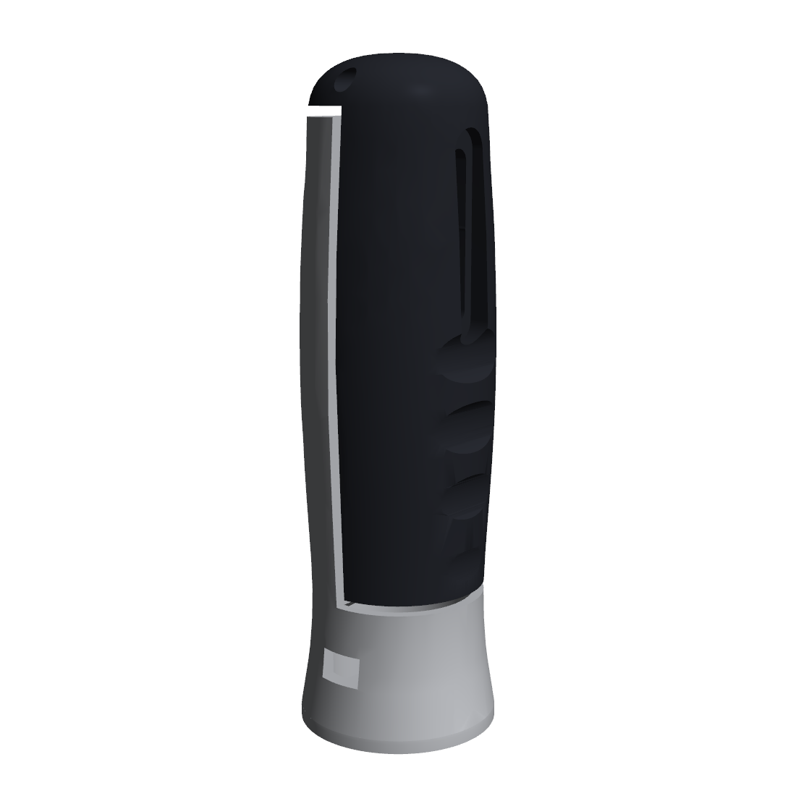
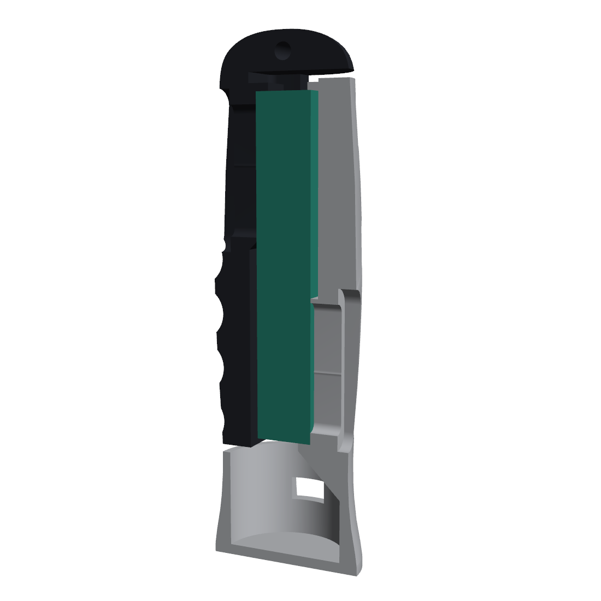
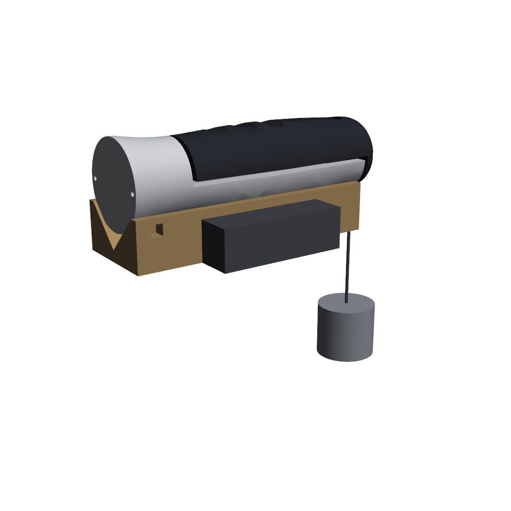

# 12 — The design: how it works and how it was arrived at

---

# Part 1 — How it works

## The one idea

The device is a round, barrel-shaped handle, split lengthwise into two halves with a 3 mm seam between them. A load cell stands upright inside.

- The **grey palm half** is bolted to the load cell's **bottom** end.
- The **black finger half** is bolted to the load cell's **top** end.
- The two halves **never touch each other.**

When you squeeze, your palm pushes the grey half and your fingers pull the black half, trying to close the seam. The only thing connecting the two halves is the load cell, so **all of the squeeze force has to pass through it.** That's what makes the reading mean anything.

## The load path, step by step

1. Your fingers pull the **black finger half** toward your palm.
2. The finger half is bolted to the **top end** of the load cell, so it pulls that end.
3. The load cell's **bottom end** is bolted to the **grey palm half**, which your palm is pushing the opposite way.
4. The load cell bends very slightly — less than a millimetre at full load. The strain gauges inside it measure that bending.
5. The **HX711** amplifies the tiny signal, the **Nano** reads it, and your laptop logs it.

If *anything* else joined the two halves — a rubbing edge, a wire pulled tight, a zip tie across the seam — some force would go around the load cell and the reading would come out low. That's why the 3 mm seam is the most important dimension on the device.

## Why a *single-point* load cell makes this work

A cheap beam load cell only reads correctly if you push exactly at one spot. The CZL601 is a **single-point** (parallel-beam) cell: it's built for weighing platforms up to 250 × 250 mm, so it reads the same whatever point on the platform the weight sits. Your hand spreads its force over most of the grip's length; this cell doesn't mind.

## What every feature is for

| Feature | Where | What it does |
|---|---|---|
| **3 mm seam** | between grey and black, everywhere | Keeps the halves from touching, so the load cell is the only load path. |
| **Pocket** (the hollow inside) | both halves | Follows the load cell's rectangular shape with exactly 3 mm of air all round, so the cell touches each half only where it's bolted. The CAD measures this: 3.00 mm from the cell's bending zone to both halves. |
| **Clamping bosses** | inside each half | Thick pads that press against the load cell's end faces. The palm half clamps only the bottom 55 mm, the finger half only the top 55 mm. The middle, where the cell actually bends, is left completely free. |
| **Ledges** | under the cell's bottom, over its top | The cell stands on one ledge; the other caps it. These set its exact position, so it doesn't depend on where the seller drilled the holes. |
| **Slots** (not round holes) | where the bolts pass | Hole positions vary between load cells. Slots let any position within an 18–22 mm window line up. They're safe because the squeeze pulls *along* the bolts, not sideways across them. |
| **Counterbores** | around each slot, outside | The bolt heads and washers sink into recesses and sit flush, so nothing digs into your hand. |
| **45° gusset** | under the bottom ledge | Supports the ledge and lets the part print without support material. |
| **45° chamfer** | under the finger-side boss | Same reason: printable without supports. |
| **Barrel shape** | the whole grip | Fuller in the middle (58 mm) than at the ends (~52 mm), matching how a hand closes. The 58 mm diameter is the grip span. |
| **Finger grooves** | black half, front | One groove per finger. They show where your hand goes and put your fingers in the same place every squeeze, which improves repeatability. |
| **Flared base** | bottom of the grey half | Lets the device stand upright without anything resting on the load cell. |
| **Electronics pod** | inside the base | Holds the Nano and HX711. Short wires to the load cell, USB port on the side. |
| **Cover** | underneath | Two screws; take it off to reach the electronics. |
| **Dome** | top of the black half | Closes the top; its hole is the calibration hook. |
| **Calibration hook** | through the dome | The only point on the finger side where a hanging cord can clear the palm half. See calibration below. |

## Calibration

The device lies in the **calibration cradle** (a printed V-block) with the **palm half facing down**, and the cradle is clamped in a bench vise. A cord through the dome hook carries a bucket of known masses. Gravity pulls the finger half toward the palm half — exactly the direction and path a squeeze takes.

Two details that matter:

- **The zip tie goes around the base pod only** — which is grey, palm side. It holds that end down so the device doesn't tip. It must **never** go around the black half, or it would join the two halves and bypass the load cell.
- **The hook is at the dome end** because it's the only place where the hanging cord doesn't touch the palm half on its way down.

## What was deliberately left out

**No overload stop.** Earlier versions had an adjustable stop bolt. It's gone, on purpose. The cell's safe overload is 120 kg; no human grip comes close. A stop exists to protect against drops, and in this shape a drop lands on the dome or the base — both push *along* the load cell's length, which is its strongest direction. A printed stop with a 0.5 mm gap also can't be made accurately enough to be worth having. Removing it removed a part, a nut, a bolt and an adjustment step.

**No display.** The laptop is the display. A screen is a good version-two feature.

---

# Part 2 — How the design was arrived at

This section records the process honestly, including the versions that didn't work. That record is as useful in an interview as the final design.

## Step 1 — Requirements first

Before any shape, the requirements that mattered most:

- All squeeze force must pass through the load cell — nothing else may join palm to fingers.
- Calibration must load the cell in the same direction and path as a squeeze.
- Grip span near the clinical standard (~48–60 mm).
- Every part printable on the Rapid Prototyping Centre's Bambu printers (256 × 256 mm bed).
- Handheld, intuitive, and good-looking enough to present.

## Step 2 — Choosing the part the design depends on

Everything is dimensioned around the load cell, so it had to be chosen first — and the first choice was wrong.

The original plan used a slim 80 × 12.7 mm bar cell. Checking availability *before* ordering showed that shape only exists up to about 50 kg; the 100 kg version isn't sold in Canada. The obvious substitute is also a trap: most "50 kg load cells" are three-wire bathroom-scale half-bridges. The design was re-based on the **CZL601 100 kg parallel-beam cell** — 130 × 30 × 22 mm, the part actually on sale.

**Lesson:** confirm your critical part is buyable before designing around it.

## Step 3 — Iterations

| Version | What it was | Why it was dropped |
|---|---|---|
| 1 — Frame | Load cell upright on a base plate, a palm wall with a gusset, a grip bar on a bracket. | Worked, but it was a bracket on a table, not a handheld instrument. Heavy, 15 h of printing, four bolt sizes. |
| 2 — Two plates | A palm plate and a finger bar bolted to opposite ends of the cell. Handheld. | Correct mechanics, but it looked like two flat slabs. |
| A — Clinical head | Load cell horizontal in a head, two handles hanging below, like a Jamar. | Lopsided: the handle hung from one end of the cell. Not intuitive. |
| S — Symmetric head | Same, but a full-width front panel let both handles hang from the centre. | Symmetric and clear, but still didn't feel right. |
| P1 — Split tube | A plain round handle split into two halves. | The right idea, but too plain. |
| **P1b — Sculpted split grip** | P1 with a barrel profile, finger grooves, flared base, dome and flush bolts. | **Chosen.** |

Every version followed the same rule — one side to each end of the cell, nothing else touching — and every version passed the same check. What changed was how well the *shape* communicated that rule to the person holding it. The final design makes it obvious: two colours, two halves, one seam.

## Step 4 — Turning a concept into a printable part

The chosen concept needed four engineering fixes before it could be built:

1. **Slots rebuilt as clean solids.** The first split-tube model's clearance check reported the load cell as completely buried in plastic. The cause was the way the bolt slots were modelled — a box plus two circles meeting at a tangent produced an invalid solid when cut into a curved surface. The check was only trustworthy after the slots were rebuilt as single clean shapes and every part was confirmed valid. **Lesson: a verification is only as good as the geometry it runs on.**
2. **One bolt size.** The first pass needed M6 × 20 on one side and M6 × 25 on the other. Deepening one set of counterbores made both M6 × 25, with 14 mm of thread in the cell on each side.
3. **Printable overhangs.** A 45° gusset under the bottom ledge and a 45° chamfer under the top boss let the internals print without support material.
4. **A proper calibration fixture.** Clamping the hollow base in a vise could crack it, and support near the base would let the device tip under load. The V-block cradle supports the palm half along its length, like a palm does, with a zip tie over the base to stop it lifting.

## Step 4b — A change prompted by a question, and an honest result

Looking at the section drawing raised a fair question: why is there so much empty space inside the black half? The original inside was a **round bore**, which gave exactly 3 mm of clearance at the load cell's corners but about 10.6 mm at the middle of each face. Under the finger grooves, that left only about 4 mm of wall.

The bore was replaced with a **pocket that follows the load cell's shape** at 3 mm all round. The results, measured in CAD:

| | Round bore | Cell-shaped pocket |
|---|---|---|
| Wall under the finger grooves | ~4 mm | **11.5 mm** |
| Section area, mid-grip | 527 mm² | 748 mm² (+42 %) |
| Bending stiffness (I), mid-grip | 29,078 mm⁴ | 35,756 mm⁴ (**×1.2**) |
| Bending stiffness (I), top groove | 32,016 mm⁴ | 30,701 mm⁴ (**×1.0**) |
| Clearance to the cell's bending zone | 3 mm (corners) | **3.00 mm everywhere** |
| Mass per half | ~64–71 g | ~78–86 g |

The prediction was "much stiffer." The measurement said otherwise, because the added material sits near the centre of the section — the *neutral axis* — where it contributes very little to bending stiffness. Stiffness comes mostly from material far from the centre, which here means the outer diameter, and that's fixed at 58 mm by the size of a hand. This is the same reason I-beams put their material in the flanges.

The change was kept anyway: the thin ligament under each groove is gone, the clearance is uniform, and the cost is about $2. But the reason for keeping it is local wall strength, not stiffness. **Lesson: predict, then measure — and report what you measured.**

## Step 5 — How the design is checked

The CAD script doesn't just draw the parts; it checks them every time it runs:

- Every part is a **valid solid.**
- The **finger half and palm side overlap by 0 mm³** — they never touch.
- The **load cell and all printed parts overlap by 0 mm³** — nothing presses into it.
- The **load cell's bending zone is at least 3 mm from both halves** — measured as a true minimum distance, not assumed.
- **Bolt engagement** is between 1.5× the bolt diameter and the depth of the cell's thread.

If a parameter change ever breaks one of these, the script says so. That's what lets you change a dimension without worrying you've broken the measurement.

## Step 6 — What you'll verify physically

The CAD can prove the geometry; only the built device proves the measurement:

- The three seams have visible clearance all the way round.
- The reading returns to zero after a hard squeeze.
- Calibration comes out linear, and a mass you didn't calibrate with reads within 2 %.

If any of those fail, the first suspect is always the seam — something touching that shouldn't be.
