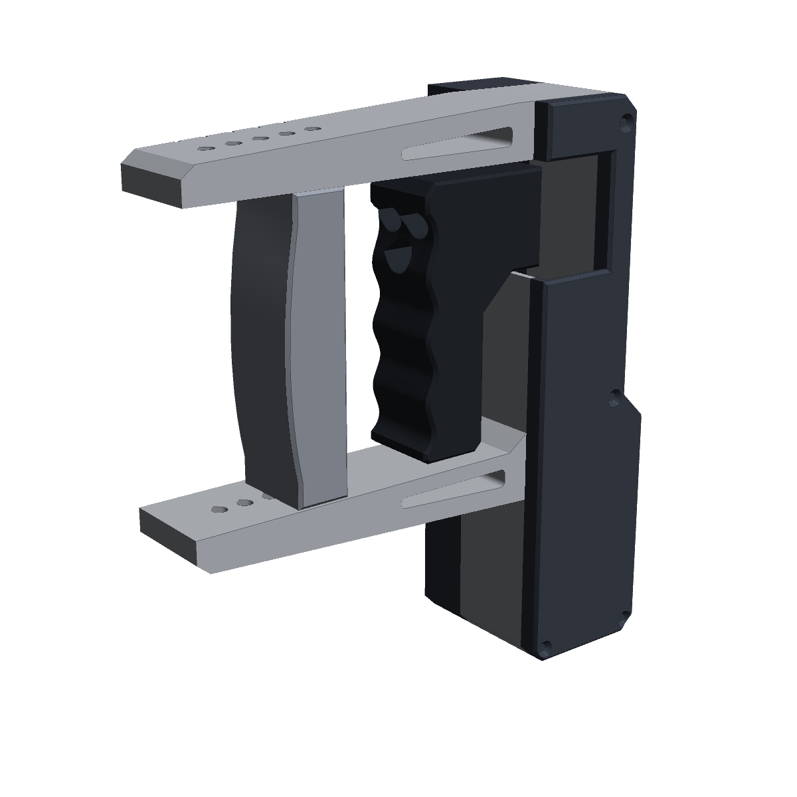
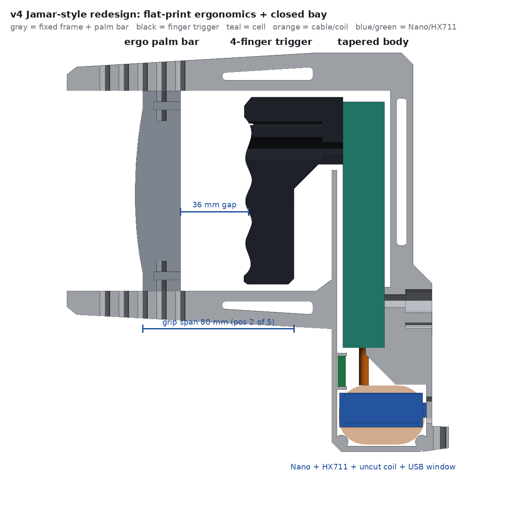
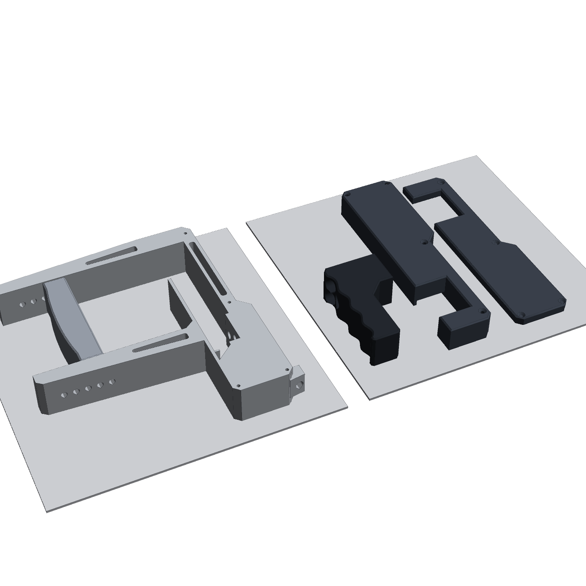
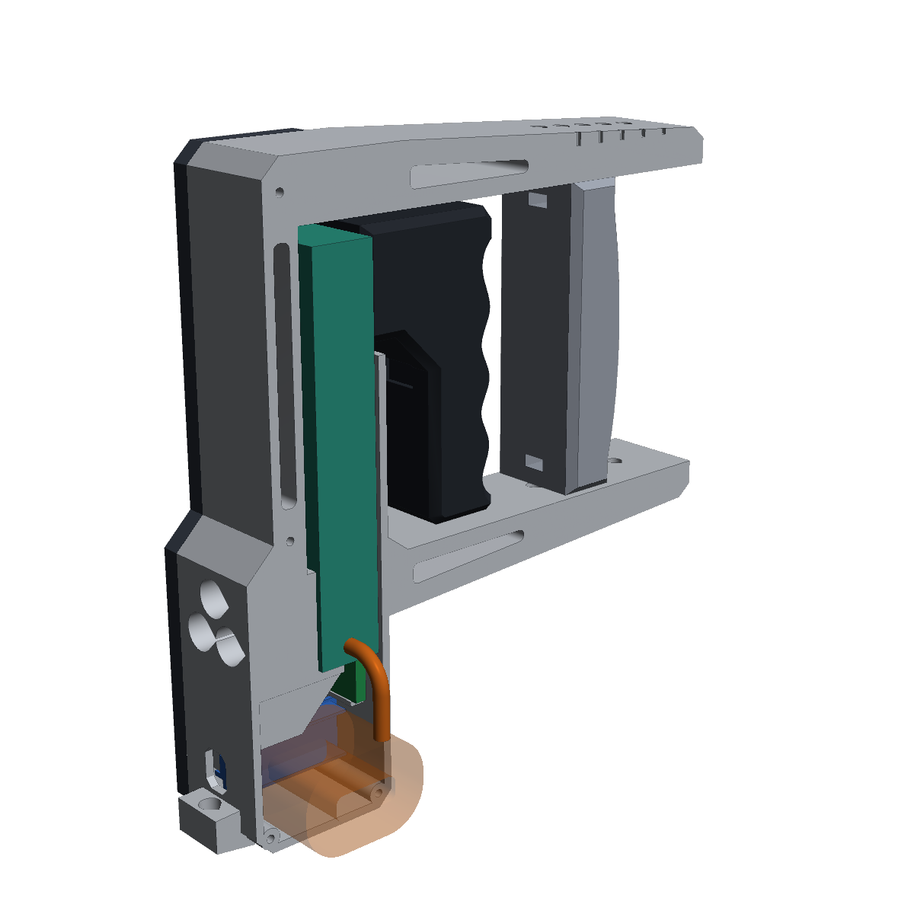

# 13 — Jamar-style two-handle dynamometer (v4 — print-ready)

A **v4** clinical-style two-handle dynamometer built around the same measured **CZL601 100 kg** load cell, `6 × M6 × 25` bolts + washers, Arduino Nano, HX711, and uncut `Ø5.13 mm` shielded cable as v3 — redesigned from the Oct 16 boxy concept (`cad/jamar_concept.py`) into an ergonomic, fast-printing, **zero-support flat-bed** build in `cad/jamar_v4.py`.

> **Build status:** **v3** remains the active calibrated bench build. **v4** is print-ready (`cad/output/jamar_v4/print_ready/`), passes every CAD/force-path/stress/electronics/coil check, and is ready for slicing on a standard `256 × 256 mm` Bambu P1S/P2S bed across 2 plates (`~399 g` PETG total, max Z-height `36.0 mm`).

## Why flat-bed split architecture

At `100 kg` (`981 N`), a `~126 mm` C-arm carries `~61.8 N·m` at its `20 mm`-deep root (`25.8 MPa` bending stress). Printing the C-frame upright puts tensile bending stress perpendicular to FDM layer lines (`~20–28 MPa` Z-yield), risking delamination.

Splitting the cell flank enclosures (`pod_cover` on `+y`, `guard_left` on `-y`) allows `frame`, `palm_bar`, and `finger_part` to print **100% flat on their `-y` side**:

- **Continuous XY fibers** run directly along the C-arms, spine, and finger bracket root (`~50 MPa` XY flexural yield → `>2.0×` safety factor at `100 kg`).
- **36.0 mm max print Z-height** (compared to `181+ mm` upright) → ~3× fewer layers and **0 g support material**.
- **Self-supporting 45° horizontal teardrops & octagonal USB window** so every horizontal M6, M5, and USB cutout bridges cleanly without supports.

## Key ergonomic & mechanical upgrades over concept

| Feature | Oct 16 concept (`jamar_concept.py`) | v4 Print-Ready (`jamar_v4.py`) |
|---|---|---|
| Handle contours | Sharp rectangular bars | **4-finger scalloped trigger** with slip guards & swept bracket (`7.5 MPa` root) + **convex palm arch** |
| Print orientation | Upright `181 mm` tall, bulky | **5 flat-bed parts**, max `36.0 mm` Z, **0 supports**, truss weight-relief slots |
| Span locking | Unspecified loose holes | **5 Jamar positions (`26–66 mm` bar gap)** indexed 1–5 with **captive M5 hex nuts** in the palm bar |
| Electronics & cable | Unplaced boards, open sides | Enclosed **`+y` pod (`18.5 mm` bend bay + `~1,121 mm` coil well)**, `-y` cell guard (`3.2 mm` clearance), Nano rails, HX711 slot & **45° octagonal rear USB window** |
| Calibration support | None | Bottom-rear **`Ø7 mm` tie-down lug** (clear below USB plug) + upper calibration strap notch on finger trigger |

## Parts & 2-plate Bambu P1S/P2S print table

| # | Part | Bed footprint (`X × Y × Z`) | Volume / ~PETG | Role |
|---|---|---|---|---|
| 1 | `1_frame_jamar_v4.stl` | `202.0 × 211.0 × 36.0 mm` | `279.1 cm³` / `~184 g` | Fixed C-frame + truss arms + Nano/HX711 rails (Plate 1, grey) |
| 2 | `2_palm_bar_jamar_v4.stl` | `24.4 × 105.6 × 36.1 mm` | `81.6 cm³` / `~54 g` | Ergonomic convex palm bar nested inside Plate 1 C-window |
| 3 | `3_finger_bar_jamar_v4.stl` | `52.6 × 99.0 × 34.1 mm` | `97.2 cm³` / `~64 g` | 4-finger sculpted trigger + swept cell bracket (Plate 2, black) |
| 4 | `4_pod_cover_jamar_v4.stl` | `53.0 × 211.0 × 23.3 mm` | `103.8 cm³` / `~69 g` | `+y` cable/coil pod + enclosed cell right flank (Plate 2, charcoal) |
| 5 | `5_guard_left_jamar_v4.stl` | `53.0 × 211.0 × 7.8 mm` | `42.9 cm³` / `~28 g` | `-y` enclosed cell flank guard (Plate 2, charcoal) |
| **Total** | **5 parts (2 plates)** | **Max Z: `36.1 mm` · 0 supports** | **`604.7 cm³` / `~399 g`** | Full assembly envelope: `202.0 × 67.1 × 211.0 mm` |

## Automated CAD verification (`python jamar_v4.py`)

Every run verifies:

- **Force path isolation:** `0.000 mm³` overlap between `finger_part` and fixed parts, `0.000 mm³` overlap on load cell, minimum `3.20 mm` air gap everywhere (`≥ 3.0 mm`), and `[23.5, 33.5, 43.5, 53.5, 63.5] mm` minimum clearances across the 5 palm-bar span stops.
- **Fasteners:** `6 × M6 × 25` button heads + `Ø12` washers (`12.4 mm` thread engagement) have `0.000 mm³` interference; `8 × M3 × 10` countersunk screws close `pod_cover` and `guard_left`; `2 × M5 × 30` bolts + `2 × M5` hex nuts lock the palm bar.
- **Uncut cable & electronics:** `18.5 mm` `+y` clearance (`R 11 mm` bend), `0.000 mm³` overlap on cable tube, `~1,121 mm` (`6` Y-layers) coil well, and `0.000 mm³` overlap on Nano, HX711, and an `18 mm` rear USB plug boot.

## Open note on clinical handle spacings

- The 5 lock positions (`26, 36, 46, 56, 66 mm` nominal bar gap; `70–110 mm` outer span) still need physical ruler confirmation against a clinical Jamar dynamometer in the BME lab or clinic before paired validity testing (`V`), since `palm_bar` holes are symmetric and easily tuned in `GAPS`.

Sources:

- [Springer BMC Musculoskeletal Disorders (2018), Jamar 5 lock positions](https://link.springer.com/article/10.1186/s12891-018-1971-4)
- [PMC10584072, second handle position used for the Jamar](https://pmc.ncbi.nlm.nih.gov/articles/PMC10584072)
