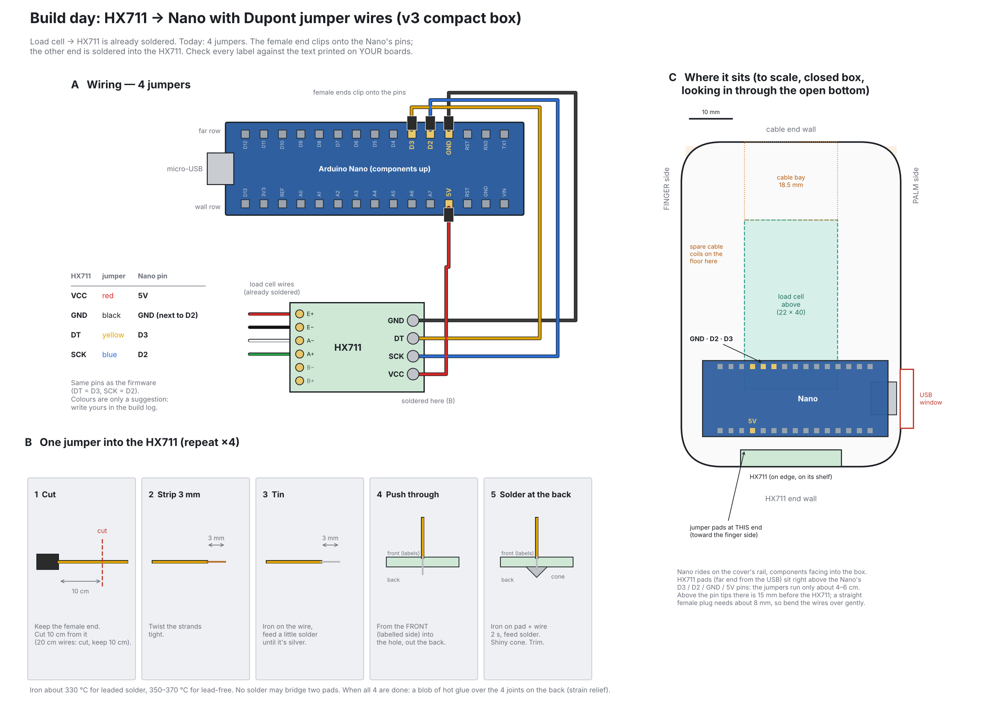

# 14 — Build day: jumpers, G1, into the box, G2

**Already done:** the load cell is soldered to the HX711 (red E+, black E−, white A−, green A+). The prints are done.
**This plan:** connect the HX711 to the Nano with Dupont jumper wires, prove it works on the bench (G1), build it into the v3 box, then check it as an assembled unit (G2).
**Time:** about 2.5 h. If you have to stop, stop after Phase 2. G1 is a good place to finish a session.

| Phase | What | Time | Ends with |
|---|---|---|---|
| 0 | Check parts, no heat | 10 min | you know which option you're doing |
| 1 | Solder 4 jumpers into the HX711 | 30–45 min | 4 shiny joints, no bridges |
| 2 | **G1** on the bench | 20 min | number moves when you press the cell |
| 3 | Build it into the box | 45 min | box closed, seams clear |
| 4 | **G2** assembled | 15 min | squeeze → number up, release → back to zero |

---

## Pick a wiring option

| | How | For | Against |
|---|---|---|---|
| **A (preferred)** | Cut each jumper and solder the cut end into the HX711. The female end clips onto the Nano's pins. | Uses only what you have. Lowest height in the box. One plug per wire that can come loose, not two. | The HX711 can't be unplugged from its wires (the Nano still can). |
| B | Solder a 4-pin header onto the HX711 and use female–female jumpers at both ends | Everything unplugs | Needs a header strip. About 15 mm of plug sticks out of the HX711 into the box, and the CAD doesn't check that. Twice as many plugs can shake loose. |
| C | Cut the jumpers and solder them at both ends (HX711 and Nano pins) | Strongest | Nothing comes apart again, which is bad while you're still debugging |

Go with **A** unless your HX711 already has header pins on its GND/DT/SCK/VCC side. In that case use B, because pulling a header off is more work than it's worth.

---

## Phase 0 — Check before you heat anything (10 min)

1. ☐ **Jumper ends.** The Nano has male pins, so every wire needs a **female** end (a socket) for the Nano. Female–female and male–female both work. With **male–male only**, nothing clips onto the Nano: do G1 on the breadboard (`images/breadboard_test.png`) and get female ends before the box.
2. ☐ Push one female end onto a Nano pin. It should grip and need a small tug to come off. If it falls off, that wire is no good inside the box.
3. ☐ **HX711 output side:** are GND / DT / SCK / VCC bare holes (option A) or pins (option B)? Read the labels on **your** board. Some boards print them in a different order, and the labels are what count, not the drawing.
4. ☐ **Load cell joints:** shiny, no loose strands touching a neighbour, zip tie strain relief about 30 mm from the cell.
5. ☐ Multimeter on Ω with nothing powered: **E+ to E− ≈ 405 Ω, A+ to A− ≈ 350 Ω** measured on the HX711 pads. A reading of 0 Ω or open (OL) means a bad cell joint. Fix that first.

## Phase 1 — Solder the jumpers into the HX711 (option A, 30–45 min)

Do one wire completely before starting the next, so they can't get mixed up. Suggested colours: **VCC red, GND black, DT yellow, SCK blue**. Use whatever you have, and write your mapping in the build log.

1. **Cut**: keep the female end, cut **10 cm** from it. On 20 cm wires, keep the 10 cm with the female end. The run inside the box is only 4–6 cm. The rest is slack so you can plug the wires in with the cover held beside the box.
2. **Strip** 3 mm. Twist the strands tight.
3. **Tin**: iron on the wire, feed a little solder until the tip is silver.
4. **Push through** from the **front** (the side with the labels) into the right hole, until the tip comes out the back.
5. **Solder at the back**: iron touching pad **and** wire, about 2 s, feed solder into the joint (not onto the iron). Stop when it forms a shiny cone. Trim the tip to about 1 mm.
   - Iron: about **330 °C** for leaded solder, **350–370 °C** for lead-free.
6. Repeat for the other three.

**Check (5 min):**
- ☐ 4 shiny cones, none dull or balled up.
- ☐ Multimeter in beep mode across **neighbouring** pads: GND–DT, DT–SCK, SCK–VCC. **None may beep.** A beep means a solder bridge. Reheat and drag it apart.
- ☐ Tug each wire gently. Nothing moves.
- ☐ Blob of **hot glue** over the 4 joints on the back. That's your strain relief.

## Phase 2 — G1 on the bench (20 min)

1. Plug the 4 female ends onto the Nano using the table below (the same pins as the firmware):

   | HX711 | Nano pin | Where on the Nano |
   |---|---|---|
   | VCC | **5V** | not VIN, not 3V3 |
   | GND | **GND** | the one between D2 and RST |
   | DT | **D3** | |
   | SCK | **D2** | |

   ⚠ **RST sits next to GND on both rows of the Nano.** A wire on RST instead of GND looks almost right and does nothing. Read the label under the plug.
2. Before USB goes in, read the four plugs once more against the table. Reversed VCC/GND can kill the HX711.
3. **Arduino IDE**
   - Library: *Sketch → Include Library → Manage Libraries*, then install **"HX711 Arduino Library" by Bogdan Necula**.
   - *Tools → Board → Arduino Nano*. *Processor → ATmega328P*. If the upload fails with a "not in sync" error, choose **ATmega328P (Old Bootloader)**. Most clone Nanos need it.
   - *Tools → Port*: pick the COM port that appears when you plug the Nano in. If no port appears, either the USB cable is charge-only (try another cable) or the clone uses a CH340 chip and needs the CH340 driver.
4. Open `firmware/hx711_bench_test/hx711_bench_test.ino` → **Upload** → *Serial Monitor* at **115200**.
5. Lay the cell flat. Hold one end down on the table and press the other end with your thumb.

**Pass (G1):** a number prints about 10 times a second. It jumps by **tens of thousands** when you press (about 43,000 counts per kg) and comes back when you let go. Take a photo of the screen.

| You see | Likely cause |
|---|---|
| `HX711 not found` | VCC or GND not on 5V/GND (check RST!), or DT and SCK swapped |
| Nothing at all / garbage characters | Serial Monitor not at 115200, or wrong port |
| Number never changes | A+ or A− joint broken. Redo the 350 Ω check from Phase 0 |
| Number jumps around wildly | A loose plug. Wiggle each wire while watching the numbers |
| Goes down instead of up | Fine. `SIGN = -1` in the firmware later |
| Upload fails | Old Bootloader, other port, other cable (step 3) |

**Log it:** a build log entry and a commit: `G1 passed: first signal from the load cell` (in your own words, today's date).

## Phase 3 — Into the box (45 min)

Follows `03_assembly.md` (v3 steps), with the wiring added.

1. **Unplug the 4 jumpers from the Nano.** They stay soldered to the HX711.
2. Cover off, palm half standing upright. Lower the **HX711 with its jumpers** down through the opening in the box top until it hangs out of the open bottom. Pull the cable through after it.
3. Lower the cell in, cable end down, onto the ledge. **3 × M6 × 25 + washers** from the palm side. Snug, then **1/8 turn** more. Paper must slide in the 3 mm gap.
4. **Coil the spare cable** on the box floor: round loops against the walls, none tighter than 2 cm, no kinks.
5. **HX711 onto its shelf** on the HX711 end wall, standing on edge, foam tape between the board and the wall.
   - **Jumper pads toward the FINGER side** (away from the USB window). That puts them right above the Nano's D3 / D2 / GND / 5V pins (sheet, panel C).
   - The load-cell wire end then faces the palm side.
6. **Nano onto the cover's rail** with foam tape, components facing into the box, USB end on the side that lines up with the USB window.
7. Hold the cover next to the open bottom and **plug the 4 jumpers back onto the Nano**, same table as Phase 2.
8. **Quick re-check:** USB straight into the Nano (the cover isn't on yet), Serial Monitor, press the cell. The number still moves? Unplug USB.
9. Swing the cover into place. **Bend the wires over gently** toward the HX711. There is 15 mm above the pin tips, and a plug needs about 8 mm. Nothing pinched under the cover, and no wire pressing on the cable coil.
10. **4 × M3 × 10** into the cover. Check that the USB plug reaches the Nano through the window.
11. **Finger half** onto the cell's top end: **3 × M6 × 25 + washers**, snug + 1/8 turn.
12. **Seam check:** paper slides through the 3 mm seam all the way round the halves and above the box. If anything rubs, stop and find out why: a rub is a force leak.

## Phase 4 — G2 (15 min)

1. Upload `firmware/grip_firmware/grip_firmware.ino`, or your own step-4 version if you've typed it. Close the Serial Monitor before running the logger.
2. Run the logger, squeeze, release, 5 times.

**Pass (G2):** the reading rises with the squeeze and returns to zero after each release, within a few hundredths of a kg. If it doesn't return to zero, something touches across a seam (step 12) or a plug is loose.

**Optional, only after G2 passes:** a small dot of hot glue on the 4 female plugs to stop them shaking off. Leave this until you're sure you won't need to rewire.

**Log it:** a build log entry (G2, any problems, your wire colours) and a commit with photos of the open box and the closed unit.

---

## After today
- **G3 calibration** needs the calibration cradle for the v3 base, which isn't designed yet. Ask for it once G2 passes.
- Then the resume bullet gets your real calibration numbers.
